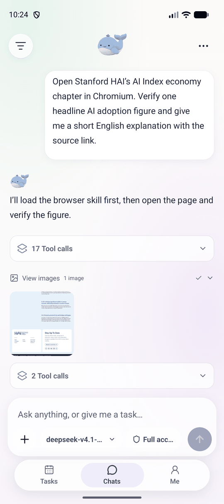
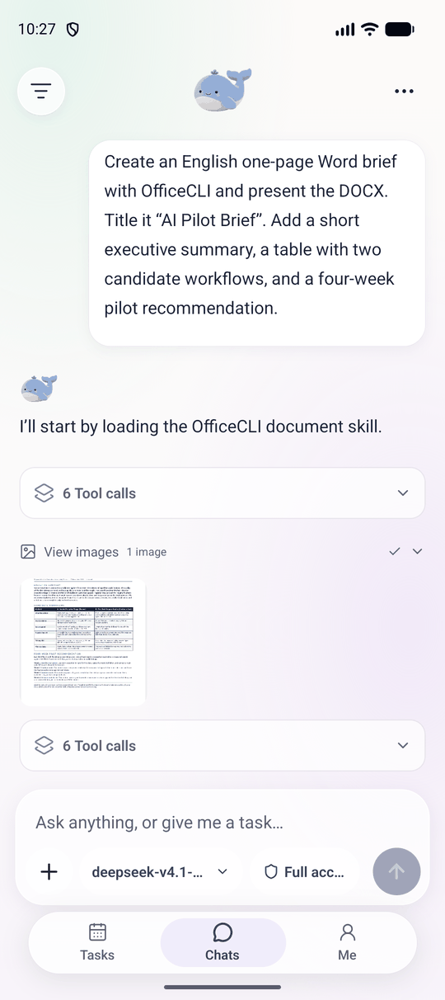
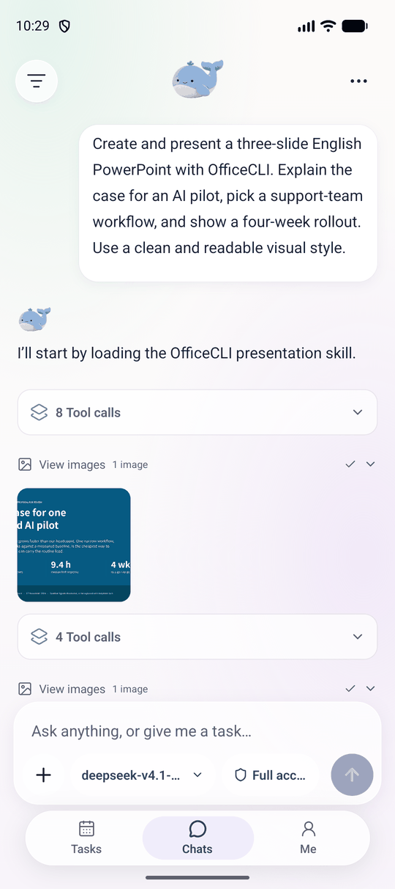
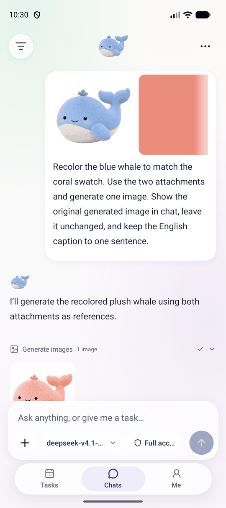
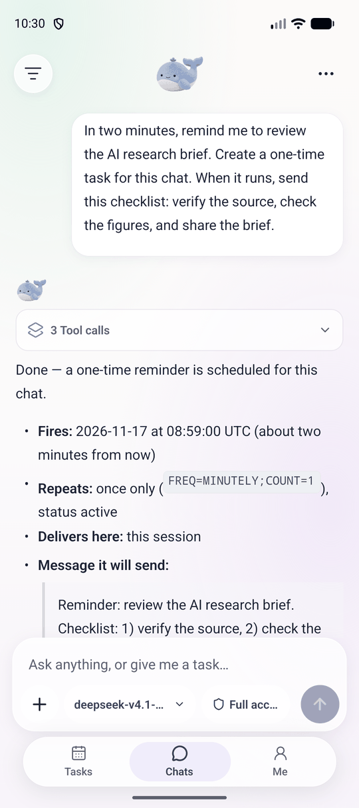
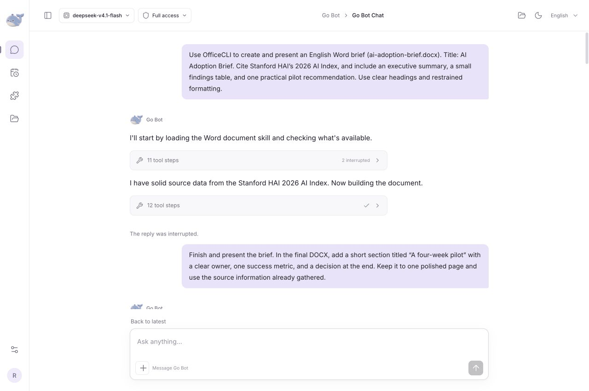
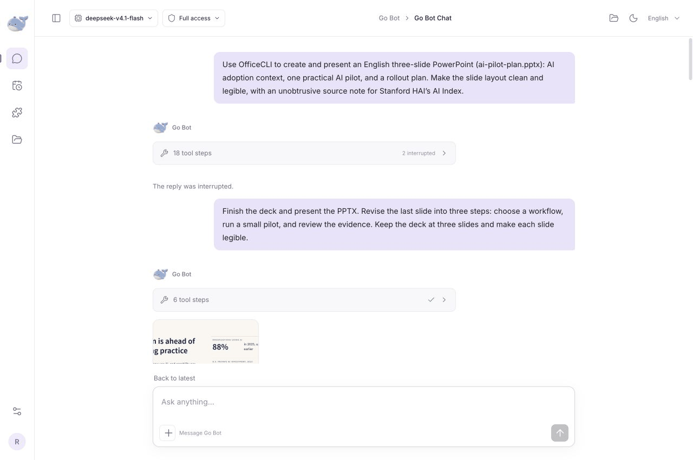
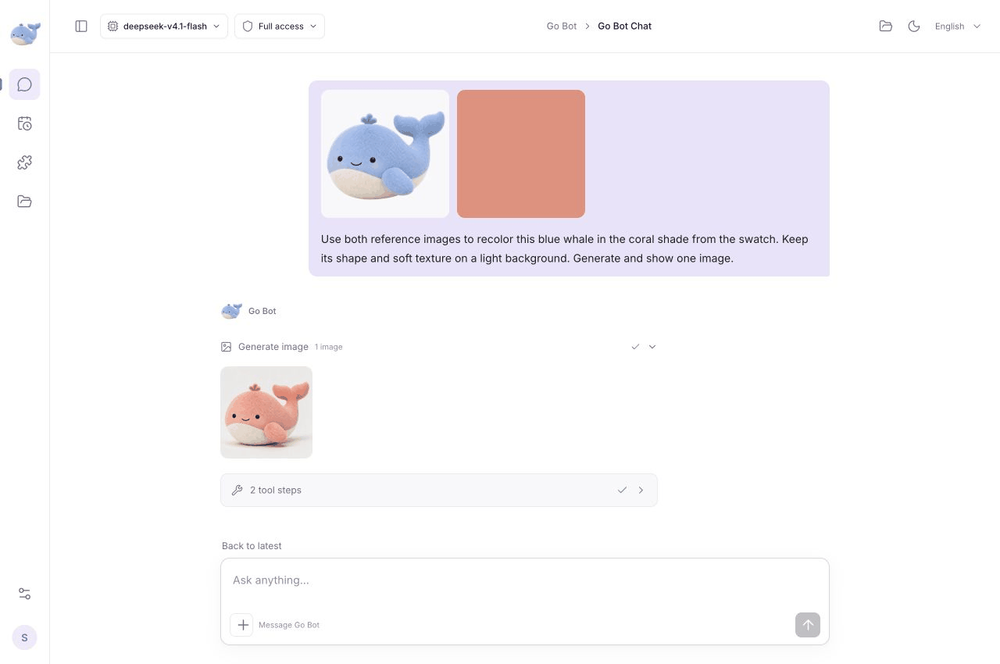

<h1 align="center">go-bot</h1>

<p align="center">
  
</p>

go-bot is a Go implementation of DeepSeek Harness and a self-hosted personal
agent. It offers an open-source alternative to [Meta Muse](https://about.fb.com/news/2026/09/introducing-muse-personal-ai-agent/),
[OpenAI dots](https://openai.com/index/introducing-dots/), and
[Grok Bot](https://help.x.com/en/using-x/about-grok).
Run locally with Docker for personal use, development, and testing.

Go Bot remembers your context and stays attentive to what matters to you,
bringing useful discoveries and ideas into the conversation on its own.

Teams can use Alibaba Cloud Elastic Container Instance (ECI) to build their
own personal agent products, with a dedicated Host for each account, optional
persistent storage, and room for their own frontends and service integrations.

<p align="center">
  <strong>English</strong> · <a href="README.zh-CN.md">简体中文</a> ·
  <strong><a href="https://github.com/xyc999-ai/go-bot/releases/latest">Download Android APK</a></strong>
</p>

- **Web research and browser automation.** Search the web through a configured provider. Use Chromium to navigate pages, interact with forms, and capture screenshots.
- **Image generation and editing.** Generate images from text or use uploaded images as references. Results appear directly in chat.
- **Office documents.** Read, create, and edit Word, PowerPoint, and Excel files with OfficeCLI, and deliver them as downloadable attachments.
- **Long-term memory and cross-session recall.** Save user preferences and agent notes per account, and search past conversations when a task needs earlier context.
- **Proactive discovery and follow-up.** Enable proactive assistance to let the agent gather and connect relevant information, explore new leads, and share useful findings and suggestions when it judges the timing is right.

The included web UI is a lightweight test client for chat, file browsing, and
downloads. Use the Controller's HTTP and server-sent events (SSE) API to
build your own mobile, desktop, or messaging interface. [HTTP API](docs/api.md) · [Minimal frontend example](examples/frontend-minimal/index.html)

[Configuration](docs/configuration.md) · [Deployment](docs/deployment.md) · [HTTP API](docs/api.md) · [Architecture](docs/architecture.md)

## Demos

### Mobile demos

The mobile client uses English prompts and connects to a local Controller and
Docker Host. The Word and PowerPoint clips show the delivered files in WPS Office.

<table align="center" width="100%">
  <tr>
    <td width="33%" valign="top" align="center">
      <h4>Browser research</h4>
      <a href="docs/showcase/en/mobile-research.gif"></a>
      <p>Verify an AI adoption figure in Chromium and get the original source in chat.</p>
    </td>
    <td width="33%" valign="top" align="center">
      <h4>Word report</h4>
      <a href="docs/showcase/en/mobile-word.gif"></a>
      <p>Ask for a Word brief with two candidate workflows and a four-week pilot.</p>
    </td>
    <td width="33%" valign="top" align="center">
      <h4>PowerPoint briefing</h4>
      <a href="docs/showcase/en/mobile-slides.gif"></a>
      <p>Create a three-slide briefing on an AI pilot for a support team.</p>
    </td>
  </tr>
</table>

<table align="center" width="67%">
  <tr>
    <td width="50%" valign="top" align="center">
      <h4>Image editing with two references</h4>
      <a href="docs/showcase/en/mobile-image.gif"></a>
      <p>Attach a whale and a color swatch, then see the coral version in the conversation.</p>
    </td>
    <td width="50%" valign="top" align="center">
      <h4>Scheduled reminder</h4>
      <a href="docs/showcase/en/mobile-schedule.gif"></a>
      <p>Create a one-time reminder and receive the checklist in the same chat when it runs.</p>
    </td>
  </tr>
</table>

### Web demos

These demos use the English web UI and a local Docker Host. The agent checks the
economic findings in Chromium and uses OfficeCLI to create and revise a Word brief
and a PowerPoint deck. [Stanford HAI 2026 AI Index](https://hai.stanford.edu/ai-index/2026-ai-index-report/economy)

<table align="center" width="100%">
  <tr>
    <td width="33%" valign="top" align="center">
      <h3>Browser research</h3>
      <a href="docs/showcase/en/web-research.gif"></a>
      <p>Check industry data in Chromium and get an English answer with source links.</p>
    </td>
    <td width="33%" valign="top" align="center">
      <h3>Word brief</h3>
      <a href="docs/showcase/en/web-word.gif"></a>
      <p>Create an AI adoption brief and revise its layout and pilot recommendation.</p>
    </td>
    <td width="33%" valign="top" align="center">
      <h3>PowerPoint briefing</h3>
      <a href="docs/showcase/en/web-slides.gif"></a>
      <p>Build a three-slide briefing and revise the last slide into a three-step rollout.</p>
    </td>
  </tr>
</table>

<table align="center" width="67%">
  <tr>
    <td width="50%" valign="top" align="center">
      <h3>Image editing with two references</h3>
      <a href="docs/showcase/en/web-image.gif"></a>
      <p>Recolor the project mascot using the original image and a reference swatch.</p>
    </td>
    <td width="50%" valign="top" align="center">
      <h3>Scheduled reminder</h3>
      <a href="docs/showcase/en/web-schedule.gif"></a>
      <p>Create a one-time reminder and get the checklist in the same chat when it runs.</p>
    </td>
  </tr>
</table>

## Quickstart

Install Docker Engine or Docker Desktop with the Docker Compose plugin
(`docker compose`). From the repository root, run:

```sh
./scripts/start.sh --init-env
./scripts/start.sh
```

The first command creates private `.env` and `.env.eci` profiles and keeps
existing files. The second reads `.env`, builds the local Host image, and
starts Controller and Redis with Compose.

### Web browser

Open the browser after startup. Controller already serves the web app.

1. Open [http://127.0.0.1:8080](http://127.0.0.1:8080) and create an account by
   name. Opening the account starts its Host in a separate Docker container and opens your main chat, with a welcome message.
2. In **Model settings**, choose **OpenAI Responses** or **Anthropic Messages** in the protocol dropdown, then add the endpoint URL, API key,
   and at least one model ID. Return to the main chat and send a message; **New chat** creates a separate conversation.
3. For web search, save a key for DeepSeek, Zhipu, Doubao, Tavily, or Brave Search under **Settings → Web search**, then choose **Use provider**. For image generation and other Gemini media capabilities, install and enable **Gemini API CLI** in the plugin market and configure its API key. [Provider setup](docs/providers.md) · [Plugin connection](docs/plugin-account-setup.md#gemini-api-cli)

Choose **English** or **简体中文** on the account page or in **Settings**. The browser remembers your choice.

New accounts automatically install and enable **agent-browser** and **OfficeCLI**. First installation downloads their official CLI dependencies while you can configure your model. Later logins reuse the installation and respect plugins you disable or uninstall. Manage them from the sidebar **Plugin market**.

Proactive assistance is enabled by default once a model is available. It researches useful opportunities and shares relevant findings in your main chat, using your model and connected service credits. You can turn it off or view its next check in **Settings → Proactive assistance**. [How it works](docs/configuration.md#proactive-assistance)

## Phone via Tailscale

Tailscale connects your phone and the computer
running Controller over a private network called a tailnet. This gives the phone
a reachable Controller URL even when it is away from your home Wi-Fi.

1. **Download Tailscale on both devices.** Open the [official Tailscale download page](https://tailscale.com/download) on the computer running Controller and choose your operating system. On the phone, follow the iOS App Store or Android Google Play link on the same page. On Android, download the Go Bot APK from the **Assets** section of the [latest GitHub Release](https://github.com/xyc999-ai/go-bot/releases/latest).
2. **Sign in with the same Tailscale account on both devices.** Follow the VPN setup prompts and turn on Tailscale on the computer and phone. Signing in adds each device to your tailnet. On the computer, open **Devices** and check that both devices are online. Select the computer to see its MagicDNS name. You can also check both devices on the [Tailscale Machines page](https://login.tailscale.com/admin/machines).

   

   *Both devices are online. The selected computer’s MagicDNS name appears on the right. The screenshot uses example names and addresses.*

3. **Start Tailscale Serve on the computer running Controller.** Run this after starting Controller. Serve forwards HTTP requests from your tailnet to Controller on `127.0.0.1:8080`. Tailscale encrypts traffic between the devices, so this setup works without HTTPS certificates.

   ```sh
   tailscale serve --bg --http=8081 http://127.0.0.1:8080
   ```

   If your terminal cannot find `tailscale`, see the [Tailscale CLI setup guide](https://tailscale.com/docs/reference/tailscale-cli?tab=macos).
4. **Connect Go Bot on the phone.** Copy the full URL printed by Serve, such as `http://my-computer.example-tailnet.ts.net:8081`. Open it in the phone's browser to check that the go-bot Web UI loads. Then enter that URL and your go-bot account name in the mobile app and tap **Connect**. New accounts can set up a model under **Me → Models**. [Tailscale Serve guide](https://tailscale.com/docs/features/tailscale-serve)

If you already have an HTTPS endpoint that your phone can reach, enter its URL directly in the app.

**Choose a deployment.** Local Docker is suited to personal development and testing. Alibaba Cloud ECI can serve as the compute foundation for an enterprise personal-agent deployment, with one on-demand Host per account and optional NAS persistence. Keep Controller behind your organization’s authenticated access layer.

## What runs where

The **Controller** serves the Web UI and HTTP API, manages Hosts, and forwards
HTTP/SSE. **Redis** stores accounts, settings and Host state. The **Host** runs
the Go agent, calls model providers directly, and manages tools, v4 session
journals, memory, schedules, attachments, and the workspace. Each account has
its own Host, started when the account is opened.

The Host includes Chromium, Python, Node.js and the general document environment.
New accounts automatically install and enable **agent-browser** and **OfficeCLI**.
Installation prepares the official CLI and its original
Skills; activation only loads those capabilities. No API key is needed.
OfficeCLI contributes 11 original Skills; agent-browser contributes its official
discovery Skill. They remain in their plugin packages under
`/root/harness/.dsh/plugins/profile/node_modules/`, rather than being copied into
user Skill directories. Disabling withdraws the Skills and retains installed CLI
software. The model discovers Skill names/descriptions and loads instructions on demand.

**Gemini API CLI** is also available in the plugin market. Install and enable it,
then choose **Accounts and authorization → Configure API Key** and enter a key from
[Google AI Studio](https://aistudio.google.com/apikey). The Agent can use the
official `gemini-api` commands for media generation, file analysis and research.
The key stays in the CLI's default `/root/.config/gemini-api/config.yaml`, outside
the workspace volume; configure it again after replacing the Host container.
[Connection guide](docs/plugin-account-setup.md#gemini-api-cli)

| Runtime | Where Host data lives | What **Stop Host** does |
| --- | --- | --- |
| Local Docker | Named volume for the account, mounted at `/root/harness` | Stops the container and keeps its files |
| ECI with `container` | Instance filesystem | Releases the instance and its files |
| ECI with `nas` | Account directory on NAS, mounted at `/root/harness` | Releases the instance and keeps NAS files |

Closing the browser leaves the Host running. For ECI, use **Stop Host** when
you no longer need the instance to stop its compute charges.

## Mobile app

The mobile app connects to the same Controller from iOS or Android. It provides chats, model switching, attachments, task status, and account settings. Enter your Controller URL and account name to connect. [Mobile development guide](mobile/README.md)

## Alibaba Cloud ECI

Run Controller and Redis with Docker Compose on a machine that can reach the
ECI private network, such as an ECS instance in the same VPC. Each account's
agent computer runs as its own ECI instance. Once the cloud resources and a
Ready image cache are in place, the same launcher starts the deployment.

### 1. Prepare Alibaba Cloud resources

| Resource | What to prepare |
| --- | --- |
| RAM credentials | Create a RAM user with an AccessKey ID and Secret. Grant the ECI API permissions needed to list, create and release instances, inspect caches, and create caches if you build them here. [Create an AccessKey pair](https://www.alibabacloud.com/help/en/ram/user-guide/create-an-accesskey-pair) · [Grant RAM permissions](https://www.alibabacloud.com/help/en/ram/user-guide/grant-permissions-to-the-ram-user) |
| Network | Choose the region, vSwitch and security group. Allow Controller to reach the ECI private IP on TCP 8080. For public registry, model and web access, configure outbound access such as NAT gateway SNAT on the ECI vSwitch. The launcher does not assign an EIP to each Host. [VPCs and vSwitches](https://www.alibabacloud.com/help/en/vpc/vpc-and-vswitch) · [Security group rules](https://www.alibabacloud.com/help/en/ecs/user-guide/security-group-rules) · [ECI internet access](https://www.alibabacloud.com/help/en/eci/user-guide/enable-internet-access) |
| NAS (optional) | Prepare a reachable NAS mount target. Before opening an account, create a writable `/go-bot/<userId>` directory on NAS for it. [Mount NAS on ECI](https://www.alibabacloud.com/help/en/eci/user-guide/mount-a-nas-volume) |
| Image cache | Reuse a Ready cache for a Linux AMD64 Host image in the selected region, or prepare a registry that the ECI cache builder can reach. [Manage ECI image caches](https://www.alibabacloud.com/help/en/eci/user-guide/manage-an-image-cache) |

### 2. Fill in the ECI profile

Run `./scripts/start.sh --init-env` if you have not initialized the profiles.
Edit `.env.eci`, which already selects `HARNESS_RUNTIME=eci`. Set
`ECI_REGION`, `ECI_VSWITCH_ID`, `ECI_SECURITY_GROUP_ID`,
`ALIBABA_CLOUD_ACCESS_KEY_ID` and `ALIBABA_CLOUD_ACCESS_KEY_SECRET`.

Keep `HARNESS_STORAGE=container` for instance storage. For persistence across
instance replacement, choose `HARNESS_STORAGE=nas` and set `NAS_MOUNT_TARGET`
to the mount target hostname. This mounts the account NAS directory before
the Host starts.

### 3. Prepare the Host image cache

If you have a Ready cache containing a compatible Host image, set
`ECI_IMAGE_CACHE_ID` and go to step 4. To build a new cache, set
`REGISTRY_PUSH_IMAGE` to a versioned registry reference such as
`registry.example.com/team/go-bot-host:v0.1.0`. For a private
registry, run `docker login <registry-host>` on the build machine if publishing
requires authentication, and set both `REGISTRY_USERNAME` and
`REGISTRY_PASSWORD` so Alibaba Cloud can pull it.

On the build machine, install Go 1.26 or newer and Docker with Buildx, then run:

```sh
./scripts/buildeci.sh prepare --env-file .env.eci
```

`prepare` builds the Linux AMD64 Host image, tags it locally with `HOST_IMAGE`,
pushes it to `REGISTRY_PUSH_IMAGE`, and requests an ECI image cache. If the
compatible AMD64 image has already been published, use
`./scripts/buildeci.sh cache --env-file .env.eci` to skip the local build and
push. Both commands wait for Ready and write `ECI_IMAGE_CACHE_ID` into the
selected profile. [Cache options and recovery](docs/deployment.md#eci-image-cache)

### 4. Start Controller and open an account

On the Controller machine, use the completed private profile:

```sh
./scripts/start.sh --env-file .env.eci
```

The launcher validates the deployment profile and starts Controller and Redis
with Compose. ECI Host instances start on demand from the configured cache
when you open an account.

## Configuration and verification

`start.sh` loads the selected profile, applies explicitly set deployment
environment variables, validates the merged configuration, and saves valid
overrides to the profile before launch. An explicitly empty value overrides a
saved value. Model and web-search settings are saved per account through the UI.
Gemini media capabilities use the API key configured in the plugin detail.

For an offline configuration check or a read-only runtime check, use:

```sh
go run ./cmd/controller check --env-file .env.eci
go run ./cmd/controller doctor --env-file .env.eci
```

Use `.env` for local Docker. `check` validates configuration, including
required fields. `doctor` also checks the selected runtime, such as the local
Host image or the Ready ECI cache. Opening an account exercises actual Host
creation, storage and Controller-to-Host connectivity.
[Configuration fields](docs/configuration.md) · [Troubleshooting](docs/troubleshooting.md)

## Dependencies

| Task | Install on the machine running it |
| --- | --- |
| Run the local or ECI deployment with `start.sh` | Docker, the Docker Compose plugin, and Bash. Go is optional because the launcher can run its configuration tools in Docker. |
| Prepare an ECI cache with `buildeci.sh` | Go 1.26 or newer and Bash. The `prepare` subcommand also needs Docker with Buildx. |
| Develop outside Docker | Go 1.26 or newer for the backend, a Redis instance for a native Controller, and Node.js 22.12+ with npm for frontend development. |

Compose runs Redis and builds the frontend. Python, Node.js, Chromium and
the general document environment are included in the Host image. Install OfficeCLI and agent-browser through the plugin market.

## Develop and extend

Build workflows around the tools the Host already provides, or add a connector
when the agent needs to query or act on a service. For example, a travel agent
could look up train or flight tickets, compare hotel rates and cancellation
terms, and draft an itinerary. To take bookings, add a provider API integration
and expose a separate confirmation step showing the chosen dates, total cost,
and cancellation terms before placing the order. Deployers supply the provider
credentials and bind access to the authenticated account.

- **Add a Skill** with a `SKILL.md` file to describe a repeatable workflow that uses existing tools. Put account-level skills under `/root/harness/.dsh/skills/` on the Host.
- **Add tools and selected third-party services** in a custom Host build. Implement the Go tool contract and include the tool in the Host's tool set. Keep external SDK and HTTP calls in `thirdparty/`, and use `providers/` for adapters to the runtime, model, search, or image provider contracts. [Tool interface](harness/agent/native_contract.go) · [Host tool assembly](harness/assembly/native_runtime.go) · [Provider guide](docs/providers.md)
- **Add business plugins** with native Cordis and asynchronous `ctx.host` APIs for tools, Skills, prompts, credentials, authorization and MCP. The Harness core stays in Go. [Plugin SDK](extensions/sdk/README.md) · [Examples](examples/plugins/README.md)
- **Build the product interface** on HTTP and SSE. Connect your own chat frontend or messaging channel and handle account authentication, connection permissions, and user approval for actions such as booking or payment. [API guide](docs/api.md) · [Personal-agent integration research](docs/personal-agent-research.zh-CN.md)

[Documentation](docs/README.md) · [Contributing](CONTRIBUTING.md) · [Security policy](SECURITY.md) · [MIT License](LICENSE) · [Third-party notices](THIRD_PARTY_NOTICES.md)

## Community

Join **go-bot交流** on QQ to ask questions, share setups, or give feedback.
Scan the QR code in QQ or search for group **710767129**.

<a href="assets/qq-community.jpg"></a>

## Upstream and acknowledgments

- [Gemini API CLI](https://github.com/google-gemini/gemini-api-cli) provides the
  official shell interface for Gemini models and managed agents.

- [DeepSeek Harness](https://github.com/deepseek-ai/deepseek-harness) is the upstream project that this Go implementation is based on. [Compatibility notes](docs/compatibility.md)
- [Hermes Agent](https://github.com/NousResearch/hermes-agent) informed the design of local long-term memory and cross-session history search. [Memory design](docs/hermes-agent-memory-design.zh-CN.md)
- [OfficeCLI](https://github.com/iOfficeAI/OfficeCLI) supplies the Word, PowerPoint, and Excel tools. The Host also includes [LibreOffice](https://www.libreoffice.org/).
- [agent-browser](https://github.com/vercel-labs/agent-browser) provides the CLI and skill the Host uses to automate [Chromium](https://www.chromium.org/).

See the [open-source memory survey](docs/open-source-agent-memory-survey.zh-CN.md)
for additional designs evaluated, and [third-party notices](THIRD_PARTY_NOTICES.md)
for bundled components and their license terms.
