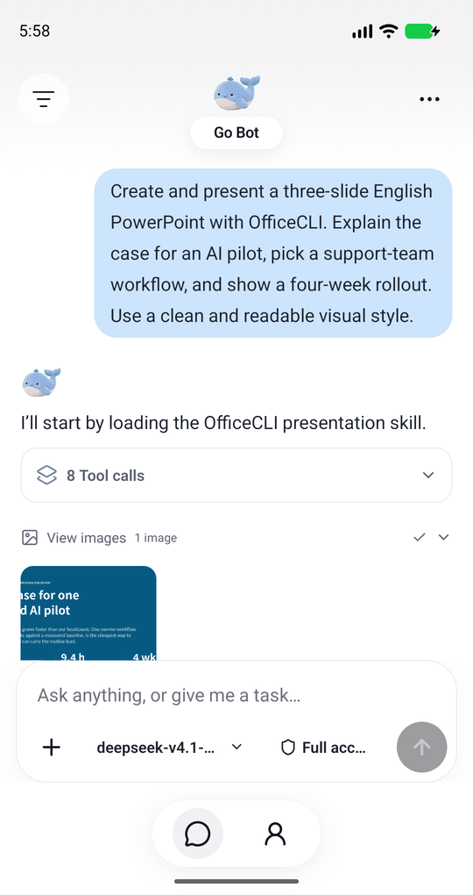
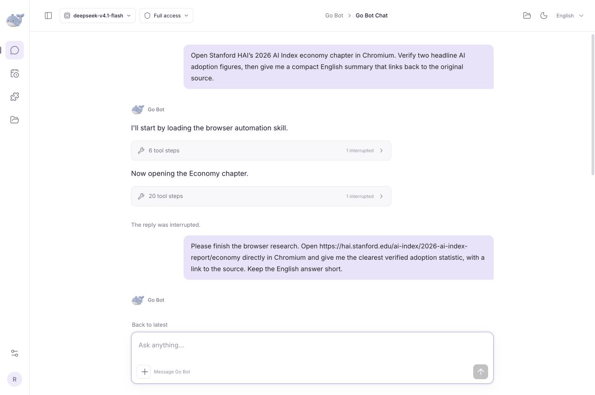
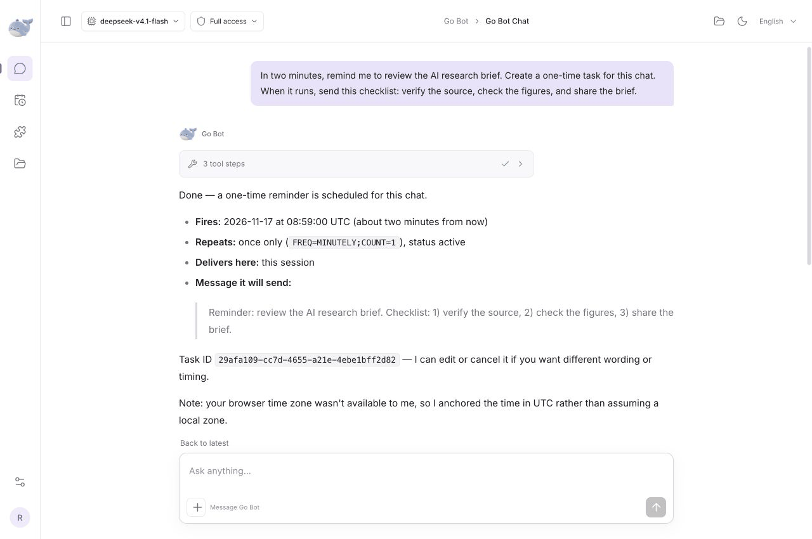

<h1 align="center">go-bot</h1>

<p align="center">
  <strong>English</strong> · <a href="README.zh-CN.md">简体中文</a>
</p>

<p align="center">
  
</p>

go-bot is a Go-based Harness system and a self-hosted personal
agent. It offers an open-source alternative to [Meta Muse](https://about.fb.com/news/2026/09/introducing-muse-personal-ai-agent/),
[OpenAI dots](https://openai.com/index/introducing-dots/), and
[Grok Bot](https://help.x.com/en/using-x/about-grok).
Run locally with Docker for personal use, development, and testing.

Go Bot remembers your context and stays attentive to what matters to you,
bringing useful discoveries and ideas into the conversation on its own.

Teams can use Alibaba Cloud Elastic Container Instance (ECI) to build their
own personal agent products, with a dedicated Host for each account, optional
persistent storage, and room for their own frontends and service integrations.

- **Web research and browser automation.** Search the web through a configured provider. Use Chromium to navigate pages, interact with forms, and capture screenshots.
- **Image generation and editing.** Generate images from text or use uploaded images as references. Results appear directly in chat.
- **Office documents.** Read, create, and edit Word, PowerPoint, and Excel files with OfficeCLI, and deliver them as downloadable attachments.
- **Long-term memory and cross-session recall.** Save user preferences and agent notes per account, and search past conversations when a task needs earlier context.
- **Proactive discovery and follow-up.** Enable proactive assistance to let the agent gather and connect relevant information, explore new leads, and share useful findings and suggestions when it judges the timing is right.

Use the Web, desktop, or mobile client for chat, file browsing, and downloads.
Use the Controller's HTTP and server-sent events (SSE) API to
build your own mobile, desktop, or messaging interface. [HTTP API](docs/api.md) · [Minimal frontend example](examples/frontend-minimal/index.html)

[Configuration](docs/configuration.md) · [Deployment](docs/deployment.md) · [HTTP API](docs/api.md) · [Architecture](docs/architecture.md) · [Plugins](https://github.com/xyc999-ai/go-bot-plugins)

## Clients and downloads

<p align="center">
  <a href="https://github.com/xyc999-ai/go-bot/releases/latest"></a>
  <a href="https://github.com/xyc999-ai/go-bot/releases/latest"></a>
  <a href="https://github.com/xyc999-ai/go-bot/releases/latest"></a>
  <a href="https://github.com/xyc999-ai/go-bot/releases/latest"></a>
</p>

Each badge opens the latest Release. Choose your platform's installer under
**Assets**. Desktop clients connect to a Controller running on the same computer;
Android connects to a reachable Controller URL. Start Controller with the
[Quickstart](#quickstart). The [Web client](#web-and-desktop) is included with Controller
and opens in your browser without a separate download.

## Demos

### Mobile demos


<table align="center" width="100%">
  <tr>
    <td width="33%" valign="top" align="center">
      <h4>Word documents</h4>
      <a href="docs/showcase/mobile/word.gif"></a>
      <p>Create an AI pilot brief, then refine its owner, success metric, and decision point.</p>
    </td>
    <td width="33%" valign="top" align="center">
      <h4>PowerPoint presentations</h4>
      <a href="docs/showcase/mobile/slides.gif"></a>
      <p>Create a three-slide deck, then revise its rollout checkpoints.</p>
    </td>
    <td width="33%" valign="top" align="center">
      <h4>Image generation and editing</h4>
      <a href="docs/showcase/mobile/image.gif"></a>
      <p>Use a whale and a color swatch as references, then preview the generated coral version.</p>
    </td>
  </tr>
</table>

<table align="center" width="67%">
  <tr>
    <td width="50%" valign="top" align="center">
      <h4>Scheduled tasks</h4>
      <a href="docs/showcase/mobile/schedule.gif"></a>
      <p>Schedule a reminder and receive its checklist in the same chat.</p>
    </td>
    <td width="50%" valign="top" align="center">
      <h4>Plugins and connectors</h4>
      <a href="docs/showcase/mobile/plugins.png"></a>
      <p>A rich ecosystem spanning browser automation, Office, Google Workspace, X, and more.</p>
    </td>
  </tr>
</table>

### Web / Desktop demos

The Web and desktop clients share a similar interface and chat experience.
These recordings use the English Web client and a local Docker Host. The agent checks the
economic findings in Chromium and uses OfficeCLI to create and revise a Word brief
and a PowerPoint deck. [Stanford HAI 2026 AI Index](https://hai.stanford.edu/ai-index/2026-ai-index-report/economy)

<table align="center" width="100%">
  <tr>
    <td width="33%" valign="top" align="center">
      <h3>Browser research</h3>
      <a href="docs/showcase/en/web-research.gif"></a>
      <p>Check industry data in Chromium and get an English answer with source links.</p>
    </td>
    <td width="33%" valign="top" align="center">
      <h3>Word brief</h3>
      <a href="docs/showcase/en/web-word.gif"></a>
      <p>Create an AI adoption brief and revise its layout and pilot recommendation.</p>
    </td>
    <td width="33%" valign="top" align="center">
      <h3>PowerPoint briefing</h3>
      <a href="docs/showcase/en/web-slides.gif"></a>
      <p>Build a three-slide briefing and revise the last slide into a three-step rollout.</p>
    </td>
  </tr>
</table>

<table align="center" width="67%">
  <tr>
    <td width="50%" valign="top" align="center">
      <h3>Image editing with two references</h3>
      <a href="docs/showcase/en/web-image.gif"></a>
      <p>Recolor the project mascot using the original image and a reference swatch.</p>
    </td>
    <td width="50%" valign="top" align="center">
      <h3>Scheduled reminder</h3>
      <a href="docs/showcase/en/web-schedule.gif"></a>
      <p>Create a one-time reminder and get the checklist in the same chat when it runs.</p>
    </td>
  </tr>
</table>

## Quickstart

Install Docker Engine or Docker Desktop with the Docker Compose plugin
(`docker compose`), curl and Bash. No source checkout or Go installation is needed:

```sh
curl -fsSL https://raw.githubusercontent.com/xyc999-ai/go-bot/main/scripts/install.sh | bash
cd go-bot
docker compose up -d
```

The installer downloads the repository's `compose.yaml`, `.env.example` and
`configs/default.yaml`, creates `.env` if missing, and pulls the published
Controller, Host and Redis images. It keeps existing configuration and does not
start services or create `.env.eci`. Compose starts Controller and Redis; each
account's Host is a separate container created by Controller. Images support
AMD64 and ARM64, selected automatically by Docker. [Source development](docs/deployment.md#source-checkout)

### Web and desktop

After starting Controller, use either the desktop app or the Web client.
They share the account, model setup and chat flow below.

1. **Open a client.** For desktop, download and install the macOS or Windows app
   from the [latest Release](https://github.com/xyc999-ai/go-bot/releases/latest),
   then open **Go Bot**; it connects to the local Controller automatically.
   For Web, visit [http://127.0.0.1:8080](http://127.0.0.1:8080) in your browser;
   Controller already serves the Web app. In either client, create an account by
   name. Opening the account starts its Host in a separate Docker container and
   opens your main chat, with a welcome message.
2. In **Model settings**, choose **OpenAI Responses** or **Anthropic Messages** in the protocol dropdown, then add the endpoint URL, API key,
   and at least one model ID. Return to the main chat and send a message; **New chat** creates a separate conversation.
3. For web search, save a key for DeepSeek, Zhipu, Doubao, Tavily, Brave Search, or Firecrawl under **Settings → Web search**, then choose **Use provider**. For image generation and other Gemini media capabilities, install and enable **Gemini API CLI** in the plugin market and configure its API key. [Provider setup](docs/providers.md) · [Plugin connection](docs/plugin-account-setup.md#gemini-api-cli)

Choose English, Simplified or Traditional Chinese, Spanish, Japanese, Brazilian Portuguese, French, German or Korean on the account page or in **Settings**. Web, desktop and mobile share these languages and remember your choice. On first launch, the interface follows the first supported system/browser language, falling back to English.

New accounts automatically install and enable **agent-browser** and **OfficeCLI**. First installation downloads their official CLI dependencies while you can configure your model. Later logins reuse the installation and respect plugins you disable or uninstall. Manage them from the sidebar **Plugin market**. Plugin packages, original Skills, icons and tutorials are published in the independent [plugin repository](https://github.com/xyc999-ai/go-bot-plugins). Refresh the market to discover newly published releases without rebuilding the Host image.

Proactive assistance is off by default. After configuring a usable model, turn it on in **Settings → Proactive assistance**. It researches useful opportunities and shares relevant findings in your main chat, using your model and connected service credits. The settings page also shows its next check. [How it works](docs/configuration.md#proactive-assistance)

## Phone via Tailscale

Tailscale connects your phone and the computer
running Controller over a private network called a tailnet. This gives the phone
a reachable Controller URL even when it is away from your home Wi-Fi.

1. **Download Tailscale on both devices.** Open the [official Tailscale download page](https://tailscale.com/download) on the computer running Controller and choose your operating system. On the phone, follow the iOS App Store or Android Google Play link on the same page. On Android, download the Go Bot APK from the **Assets** section of the [latest GitHub Release](https://github.com/xyc999-ai/go-bot/releases/latest).
2. **Sign in with the same Tailscale account on both devices.** Follow the VPN setup prompts and turn on Tailscale on the computer and phone. Signing in adds each device to your tailnet. On the computer, open **Devices** and check that both devices are online. Select the computer to see its MagicDNS name. You can also check both devices on the [Tailscale Machines page](https://login.tailscale.com/admin/machines).

   

   *Both devices are online. The selected computer’s MagicDNS name appears on the right. The screenshot uses example names and addresses.*

3. **Start Tailscale Serve on the computer running Controller.** Run this after starting Controller. Serve forwards HTTP requests from your tailnet to Controller on `127.0.0.1:8080`. Tailscale encrypts traffic between the devices, so this setup works without HTTPS certificates.

   ```sh
   tailscale serve --bg --http=8081 http://127.0.0.1:8080
   ```

   If your terminal cannot find `tailscale`, see the [Tailscale CLI setup guide](https://tailscale.com/docs/reference/tailscale-cli?tab=macos).
4. **Connect Go Bot on the phone.** Copy the full URL printed by Serve, such as `http://my-computer.example-tailnet.ts.net:8081`. Open it in the phone's browser to check that the go-bot Web UI loads. Then enter that URL and your go-bot account name in the mobile app and tap **Connect**. New accounts can set up a model under **Me → Models**. [Tailscale Serve guide](https://tailscale.com/docs/features/tailscale-serve)

If you already have an HTTPS endpoint that your phone can reach, enter its URL directly in the app.

**Choose a deployment.** Local Docker is suited to personal development and testing. Alibaba Cloud ECI can serve as the compute foundation for an enterprise personal-agent deployment, with one on-demand Host per account and optional NAS persistence. Keep Controller behind your organization’s authenticated access layer.

## What runs where

The **Controller** serves the Web UI and HTTP API, manages Hosts, and forwards
HTTP/SSE. **Redis** stores accounts, settings and Host state. The **Host** runs
the Go agent, calls model providers directly, and manages tools, v4 session
journals, memory, schedules, attachments, and the workspace. Each account has
its own Host, started when the account is opened.

The Host includes Chromium, Python, Node.js and the general document environment.
New accounts automatically install and enable **agent-browser** and **OfficeCLI**.
Installation prepares the official CLI and its original
Skills; activation only loads those capabilities. No API key is needed.
OfficeCLI contributes 11 original Skills; agent-browser contributes its official
discovery Skill. They remain in their plugin packages under
`/root/harness/.dsh/plugins/profile/node_modules/`, rather than being copied into
user Skill directories. Disabling withdraws the Skills and retains installed CLI
software. The model discovers Skill names/descriptions and loads instructions on demand.

**Gemini API CLI** is also available in the plugin market. Install and enable it,
then choose **Accounts and authorization → Configure API Key** and enter a key from
[Google AI Studio](https://aistudio.google.com/apikey). The Agent can use the
official `gemini-api` commands for media generation, file analysis and research.
The key stays in the CLI's default `/root/.config/gemini-api/config.yaml`, outside
the workspace volume; configure it again after replacing the Host container.
[Connection guide](docs/plugin-account-setup.md#gemini-api-cli)

| Runtime | Where Host data lives | What **Stop Host** does |
| --- | --- | --- |
| Local Docker | Named volume for the account, mounted at `/root/harness` | Stops the container and keeps its files |
| ECI with `container` | Instance filesystem | Releases the instance and its files |
| ECI with `nas` | Account directory on NAS, mounted at `/root/harness` | Releases the instance and keeps NAS files |

Closing the browser leaves the Host running. For ECI, use **Stop Host** when
you no longer need the instance, to stop its compute charges.

## Mobile app

The mobile app connects to the same Controller from iOS or Android. It provides chats, model switching, attachments, task status, and account settings. Enter your Controller URL and account name to connect. [Mobile development guide](mobile/README.md)

## Alibaba Cloud ECI

Run Controller and Redis with Docker Compose on a machine that can reach the
ECI private network, such as an ECS instance in the same VPC. Each account's
agent computer runs as its own ECI instance. Go Bot provides the preparation
tools; you run them with your own cloud configuration and then start the services
yourself. The local-Docker Quickstart installer does not prepare ECI or create
cloud resources.

### 1. Clone the repository and prepare local tools

On the Controller machine, install Git, Docker with Compose v2, and Bash. Then run:

```sh
git clone https://github.com/xyc999-ai/go-bot.git
cd go-bot
docker pull ghcr.io/xyc999-ai/go-bot-controller:latest
docker pull redis:8-alpine
./scripts/start.sh --init-env
```

This explicitly initializes `.env` and `.env.eci` without overwriting existing
files. ECI uses `.env.eci`. The Controller image contains the cache tool; no local
Go installation or Host image download is needed. These commands do not start
Controller, Redis or an account Host.

### 2. Prepare cloud resources and fill in `.env.eci`

| Resource | What to prepare |
| --- | --- |
| RAM credentials | Create a RAM user with an AccessKey ID and Secret. Grant the ECI API permissions needed to list, create and release instances, inspect caches, and create caches if you build them here. [Create an AccessKey pair](https://www.alibabacloud.com/help/en/ram/user-guide/create-an-accesskey-pair) · [Grant RAM permissions](https://www.alibabacloud.com/help/en/ram/user-guide/grant-permissions-to-the-ram-user) |
| Network | Choose the region, vSwitch and security group. Allow Controller to reach the ECI private IP on TCP 8080. For public registry, model and web access, configure outbound access such as NAT gateway SNAT on the ECI vSwitch. The launcher does not assign an EIP to each Host. [VPCs and vSwitches](https://www.alibabacloud.com/help/en/vpc/vpc-and-vswitch) · [Security group rules](https://www.alibabacloud.com/help/en/ecs/user-guide/security-group-rules) · [ECI internet access](https://www.alibabacloud.com/help/en/eci/user-guide/enable-internet-access) |
| NAS (optional) | Prepare a reachable, writable NAS mount target. Each account's data uses `/go-bot/<userId>` on NAS, mounted at `/root/harness` in the Host. [Mount NAS on ECI](https://www.alibabacloud.com/help/en/eci/user-guide/mount-a-nas-volume) |
| Image cache | Create it in step 3 from the public Host image, or reuse a Ready cache for exactly the same `HOST_IMAGE` in the selected region. [Manage ECI image caches](https://www.alibabacloud.com/help/en/eci/user-guide/manage-an-image-cache) |

Edit `.env.eci`, which already selects `HARNESS_RUNTIME=eci`. Set
`ECI_REGION`, `ECI_VSWITCH_ID`, `ECI_SECURITY_GROUP_ID`,
`ALIBABA_CLOUD_ACCESS_KEY_ID` and `ALIBABA_CLOUD_ACCESS_KEY_SECRET`.

Keep `HARNESS_STORAGE=container` for instance storage. For persistence across
instance replacement, choose `HARNESS_STORAGE=nas` and set `NAS_MOUNT_TARGET`
to the mount target hostname. This mounts the account NAS directory before
the Host starts.

### 3. Prepare the Host image cache

Leave `HOST_IMAGE` at the public image address supplied by the template. If you
already have a Ready cache for that exact image, set `ECI_IMAGE_CACHE_ID` and go
to step 4. Otherwise, explicitly create the cache:

```sh
./scripts/buildeci.sh --env-file .env.eci
```

The script runs the cache tool inside the already-pulled Controller image.
Alibaba Cloud pulls the AMD64 variant of the public `HOST_IMAGE`; no local
Host build, push, Go installation or registry login is needed. It waits for
Ready and writes `ECI_IMAGE_CACHE_ID` back into `.env.eci`. Cache creation uses
billable Alibaba Cloud resources. There are no registry credentials or separate
push-address settings: the cache tool uses the public `HOST_IMAGE` directly.
This command only prepares the cache; it does not start Controller, Redis or
an account Host. A failed or timed-out run does not replace the saved cache ID.
[API parameters, cache options and recovery](docs/deployment.md#cache-api-request)

### 4. Start Controller and open an account

On the Controller machine, use the completed private profile:

```sh
./scripts/start.sh --env-file .env.eci
```

The launcher validates the deployment profile and starts Controller and Redis
with Compose. Open the Controller URL in your browser and create or open an
account. Only then does Controller create that account's ECI Host, passing
`HOST_IMAGE` and `ECI_IMAGE_CACHE_ID` directly to Alibaba Cloud. Preparing a cache
alone does not create a user Host. When changing the Host image, create a new
cache and update its ID before replacing the account's instance.

## Configuration and verification

Controller reads the mounted `.env` and `configs/default.yaml` and validates
them at startup, including when started directly with Compose. Edit `.env` to
change deployment settings. The source-only `start.sh` forwards
explicit shell overrides to Controller; it never pulls or builds images. Process
environment overrides apply in memory only and never modify `.env`. An explicitly
empty override clears the effective value for that process. Compose mounts only
the selected env file and runtime YAML, both read-only.
Model and web-search settings are saved per account through the UI.
Gemini media capabilities use the API key configured in the plugin detail.

For an offline configuration check or a read-only runtime check, use:

```sh
docker compose run --rm --no-deps controller check --env-file /config/deployment.env --config /runtime.yaml
docker compose run --rm --no-deps controller doctor --env-file /config/deployment.env --config /runtime.yaml
```

For ECI, prefix these commands with `GO_BOT_ENV_FILE=.env.eci` to select the
profile. These commands use tools
in the existing Controller image and need no local Go or running Redis.
`check` validates configuration, including
required fields. `doctor` also checks the selected runtime, such as the local
Host image or the Ready ECI cache. Opening an account exercises actual Host
creation, storage and Controller-to-Host connectivity.
[Configuration fields](docs/configuration.md) · [Troubleshooting](docs/troubleshooting.md)

## Dependencies

| Task | Install on the machine running it |
| --- | --- |
| Quickstart | Docker Engine or Docker Desktop, Docker Compose v2, curl and Bash. |
| Start services from a source checkout with `scripts/start.sh` | Docker, Docker Compose v2 and Bash. Prepare the deployment profile and required local images first; this script neither pulls nor builds images. |
| Prepare an ECI image cache with `scripts/buildeci.sh` | Docker, Docker Compose v2 and Bash, the local Controller image, and an ECI profile with cloud credentials and network settings. |
| Develop outside Docker | Go 1.26 or newer for the backend, a Redis instance for a native Controller, and Node.js 22.12+ with npm for frontend development. |
| Develop the Cordis plugin runtime | Node.js 24.9+ and pnpm 11.25.0, as declared in `extensions/cordis/package.json`. |

The [ECI workflow](#alibaba-cloud-eci) also uses Git to obtain the source checkout
and requires the cloud resources described there. `buildeci.sh` starts a temporary
container from the Controller image and runs its bundled `buildeci` program.
It calls Alibaba Cloud to pull the Host image and create the cache, then writes
the Ready cache ID back to the selected env file. This requires neither a running
Controller service nor a local Host build or Go installation, and does not start
an account Host.

Compose runs Redis and the published Controller with its embedded frontend. Python,
Node.js, Chromium and the general document environment are included in the Host
image. New accounts automatically install and enable agent-browser and OfficeCLI,
including their official CLI dependencies and Skills; first-time installation
requires network access. Manage them later through the plugin market.

## Plugins

Plugins live in the separate [go-bot-plugins repository](https://github.com/xyc999-ai/go-bot-plugins).
It contains the plugin packages, display resources, upstream Skills and versioned
market catalog. Plugin releases are independent of Controller and Host images.
Browse integrations such as agent-browser, OfficeCLI, Google Workspace, X and
Gemini API CLI, then install and enable them from **Plugin market** in Go Bot.

To add an integration or improve an existing plugin, submit your pull request to
the plugin repository. The [plugin contribution guide](CONTRIBUTING.md#contributing-plugins)
explains where to put code, the package rules and the checks to run.

## Develop and extend

Build workflows around the tools the Host already provides, or add a connector
when the agent needs to query or act on a service. For example, a travel agent
could look up train or flight tickets, compare hotel rates and cancellation
terms, and draft an itinerary. To take bookings, add a provider API integration
and expose a separate confirmation step showing the chosen dates, total cost,
and cancellation terms before placing the order. Deployers supply the provider
credentials and bind access to the authenticated account.

- **Add tools and selected third-party services** in a custom Host build. Implement the Go tool contract and include the tool in the Host's tool set. Keep external SDK and HTTP calls in `thirdparty/`, and use `providers/` for adapters to the runtime, model, search, or image provider contracts. [Tool interface](harness/agent/native_contract.go) · [Host tool assembly](harness/assembly/native_runtime.go) · [Provider guide](docs/providers.md)
- **Add plugins** in [go-bot-plugins](https://github.com/xyc999-ai/go-bot-plugins), using native Cordis and asynchronous `ctx.host` APIs for tools, Skills, prompts, credentials, authorization and MCP. The Harness core stays in Go. [Plugin SDK](extensions/sdk/README.md) · [Examples](examples/plugins/README.md) · [Plugin contributions](CONTRIBUTING.md#contributing-plugins)
- **Build the product interface** on HTTP and SSE. Connect your own chat frontend or messaging channel and handle account authentication, connection permissions, and user approval for actions such as booking or payment. [API guide](docs/api.md)

[Documentation](docs/README.md) · [Contributing](CONTRIBUTING.md) · [Security policy](SECURITY.md) · [MIT License](LICENSE) · [Third-party notices](THIRD_PARTY_NOTICES.md)

## Support and contribute

If Go Bot is useful to you, please give the project a [Star on GitHub](https://github.com/xyc999-ai/go-bot).
It helps others discover the project.

Ideas, experiments and pull requests are welcome: new features, bug fixes,
plugins, documentation, translations and examples all help. You can contribute
directly without opening an issue first. See [Contributing](CONTRIBUTING.md), or
explore the [plugin repository](https://github.com/xyc999-ai/go-bot-plugins).

## Community and contact

Questions, ideas, and feedback are welcome. [Open an issue](https://github.com/xyc999-ai/go-bot/issues/new)
or contact the project author directly:

- Email: [xyc00666@gmail.com](mailto:xyc00666@gmail.com)
- WeChat: `Xyc--999`
- X: [@xyc_999](https://x.com/xyc_999)

Teams and individuals interested in commercializing the project are also welcome to get in touch.

### QQ community

Join **go-bot交流** on QQ to ask questions, share setups, or give feedback.
Scan the QR code in QQ or search for group **710767129**.

<a href="assets/qq-community.jpg"></a>

## Upstream and acknowledgments

- [Gemini API CLI](https://github.com/google-gemini/gemini-api-cli) provides the
  official shell interface for Gemini models and managed agents.

- [DeepSeek Harness](https://github.com/deepseek-ai/deepseek-harness) is the upstream project that this Go implementation is based on. [Compatibility notes](docs/compatibility.md)
- [Hermes Agent](https://github.com/NousResearch/hermes-agent) informed the design of local long-term memory and cross-session history search. [Memory design](docs/hermes-agent-memory-design.zh-CN.md)
- [OfficeCLI](https://github.com/iOfficeAI/OfficeCLI) supplies the Word, PowerPoint, and Excel tools. The Host also includes [LibreOffice](https://www.libreoffice.org/).
- [agent-browser](https://github.com/vercel-labs/agent-browser) provides the CLI and skill the Host uses to automate [Chromium](https://www.chromium.org/).

See [third-party notices](THIRD_PARTY_NOTICES.md) for bundled components and
their license terms.
