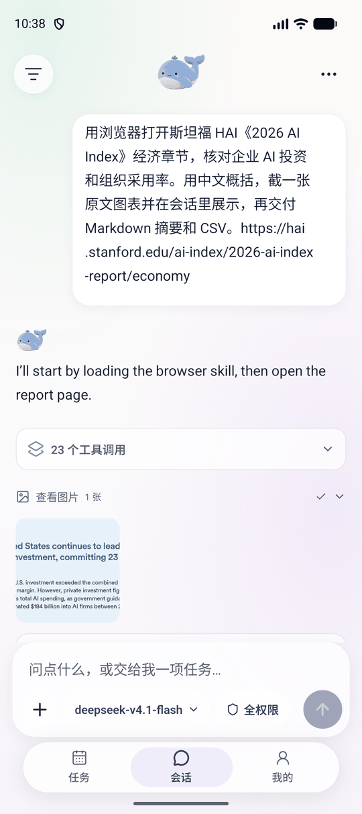
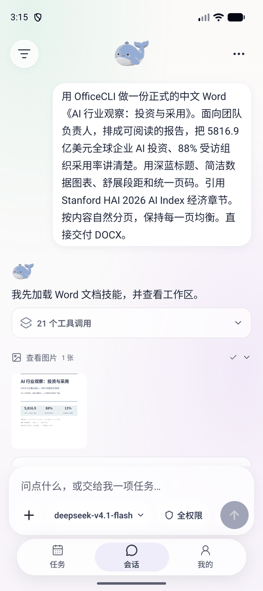
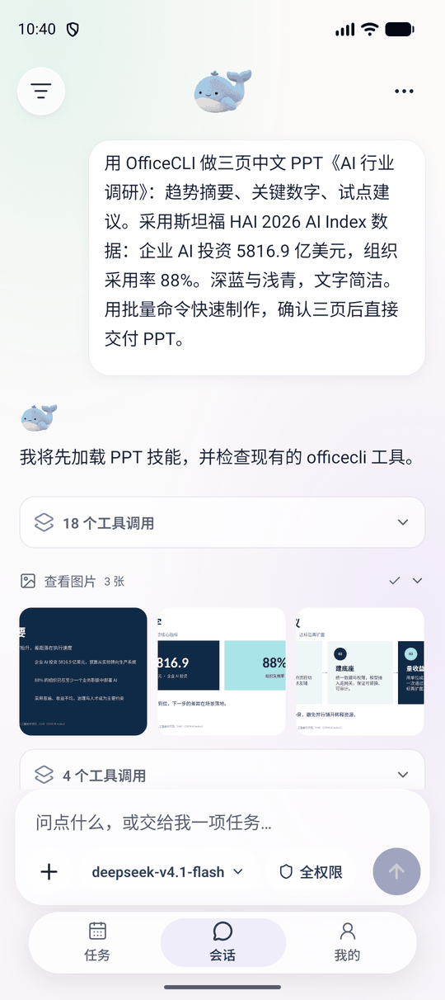
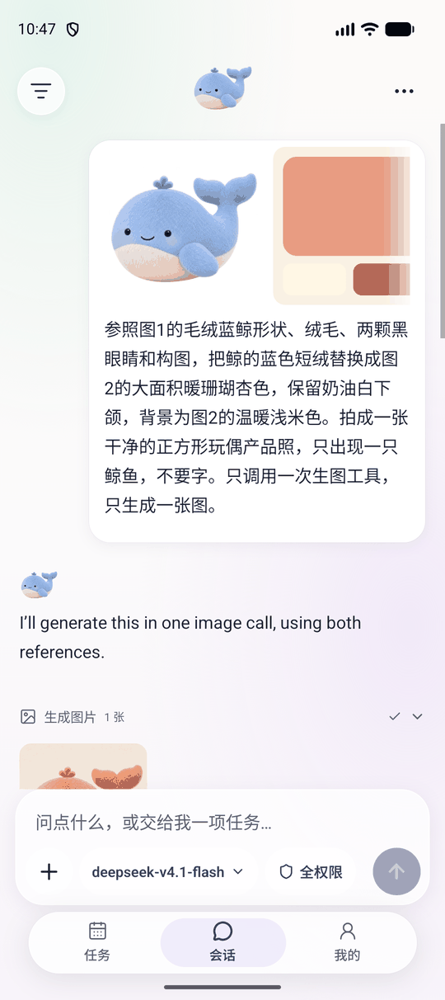
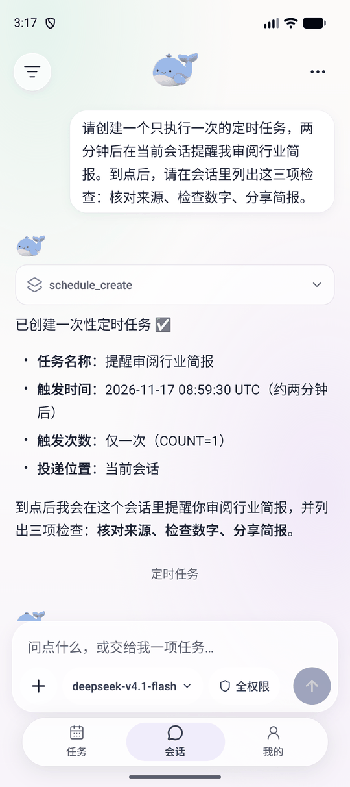
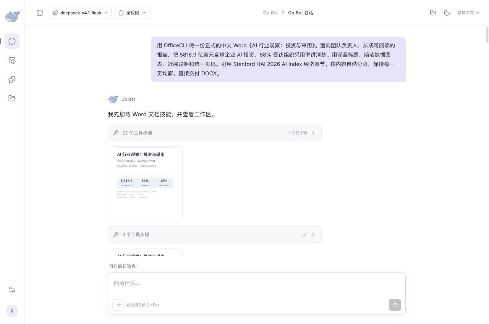
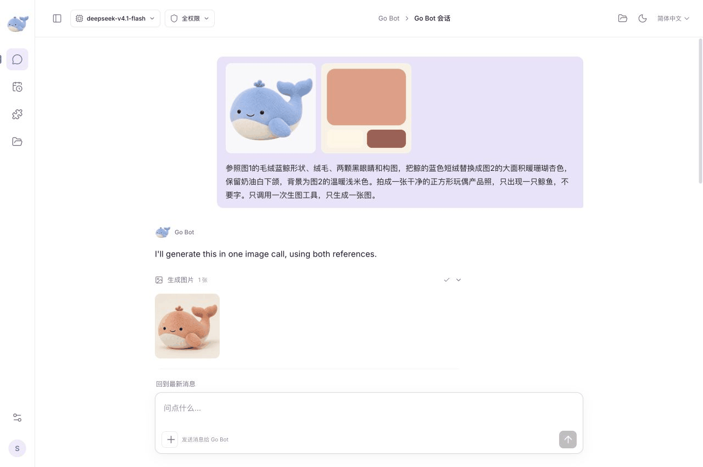

<h1 align="center">go-bot</h1>

<p align="center">
  
</p>

go-bot 是用 Go 实现的 DeepSeek Harness，也是一款可自托管的 Personal Agent，
可作为 [Meta Muse](https://about.fb.com/news/2026/09/introducing-muse-personal-ai-agent/)、
[OpenAI dots](https://openai.com/zh-Hans-CN/index/introducing-dots/) 和
[Grok Bot](https://help.x.com/en/using-x/about-grok) 的开源替代方案。个人可以用 Docker 在本地运行、开发和测试。

Go Bot 会记住与你交流的背景，持续关注你关心的事，并主动带来值得了解的新发现和想法。

企业团队可以用阿里云弹性容器实例（ECI）为每个账号按需启动独立 Host，按需持久化数据，
并接入自己的前端和业务服务，构建自己的 Personal Agent 产品。

<p align="center">
  <a href="README.md">English</a> · <strong>简体中文</strong> ·
  <strong><a href="https://github.com/xyc999-ai/go-bot/releases/latest">下载 Android APK</a></strong>
</p>

- **网络搜索和浏览器操作。** 配置搜索供应商后即可检索网页。Agent 能操作 Chromium，打开页面、填写表单和截图。
- **生成和编辑图片。** 可以用文字生图，也可以上传多张参考图，生成结果会直接显示在会话中。
- **处理 Office 文件。** 使用 OfficeCLI 读取、生成和编辑 Word、PPT、Excel 文件，并提供下载。
- **长期记忆和跨会话检索。** 按账号保存用户偏好和 Agent 笔记，任务需要时可以查找同账号的历史会话。
- **主动发现与跟进。** 启用主动服务后，AI 会结合对你的了解收集和梳理相关信息，探索值得关注的新线索，并在它认为合适的时候，主动与你分享新的发现和建议。

内置网页是用于测试的轻量界面，提供聊天、浏览文件和下载交付物。你可以通过 Controller 的 HTTP接口接入自己的移动端、桌面端或消息渠道。 [HTTP API](docs/api.md) · [最小前端示例](examples/frontend-minimal/index.html)

[配置](docs/configuration.md) · [部署](docs/deployment.md) · [HTTP API](docs/api.md) · [架构](docs/architecture.md)

## 演示

### 移动端演示

以下从移动端展示的中文会话均使用本地 Controller 和 Docker Host。Word 和 PPT 的动图末尾展示了在 WPS Office 中打开的成品。

<table align="center" width="100%">
  <tr>
    <td width="33%" valign="top" align="center">
      <h4>浏览器调研</h4>
      <a href="docs/showcase/mobile-research-demo.gif"></a>
      <p>核对斯坦福 AI Index，在会话中收到原文图表、摘要和数据表。<br><a href="docs/showcase/mobile-research-key.png">查看原尺寸关键帧</a></p>
    </td>
    <td width="33%" valign="top" align="center">
      <h4>Word 行业报告</h4>
      <a href="docs/showcase/mobile-word-demo.gif"></a>
      <p>制作行业报告，再补充调查口径和适合团队落地的试点方案。<br><a href="docs/showcase/mobile-word-key.png">查看原尺寸关键帧</a></p>
    </td>
    <td width="33%" valign="top" align="center">
      <h4>PPT 汇报</h4>
      <a href="docs/showcase/mobile-slides-demo.gif"></a>
      <p>调整采用率说明，把最后一页改成三步试点计划。<br><a href="docs/showcase/mobile-slides-key.png">查看原尺寸关键帧</a></p>
    </td>
  </tr>
</table>

<table align="center" width="67%">
  <tr>
    <td width="50%" valign="top" align="center">
      <h4>两张参考图编辑图片</h4>
      <a href="docs/showcase/mobile-image-demo.gif"></a>
      <p>结合参考图为鲸鱼换色，全屏预览后保存到手机图库。<br><a href="docs/showcase/mobile-image-key.png">查看原尺寸关键帧</a></p>
    </td>
    <td width="50%" valign="top" align="center">
      <h4>定时任务</h4>
      <a href="docs/showcase/mobile-schedule-demo.gif"></a>
      <p>在手机会话中查看定时任务的创建确认，以及随后送达的检查清单。</p>
    </td>
  </tr>
</table>

### 网页端演示

演示通过内置网页和本地 Docker Host 运行，所有会话均用中文提问。Agent 用 Chromium 查阅
[斯坦福 HAI《2026 AI Index》经济章节](https://hai.stanford.edu/ai-index/2026-ai-index-report/economy)，
再用 OfficeCLI 把查到的资料整理成 Word 行业报告和 PPT，并根据后续消息修改两份文件。

<table align="center" width="100%">
  <tr>
    <td width="33%" valign="top" align="center">
      <h3>浏览器调研</h3>
      
      <p>Agent 用 Chromium 核对行业数据，交付原文图表和调研摘要。</p>
      <a href="docs/showcase/ai-research-chat.webp">看会话截图</a> · <a href="docs/showcase/ai-index-source.webp">看原站图表</a>
    </td>
    <td width="33%" valign="top" align="center">
      <h3>Word 行业报告</h3>
      
      <p>制作含封面、数据图表和清晰正文层次的行业报告，再按反馈校订内容与分页，在 WPS Office 中查看最终成品。</p>
      <a href="docs/showcase/ai-word-demo.gif">查看大图</a>
    </td>
    <td width="33%" valign="top" align="center">
      <h3>PPT 汇报</h3>
      
      <p>核对行业数据、补充调查口径并修改汇报，在 WPS Office 中展示关键数字页。</p>
      <a href="docs/showcase/ai-slides-demo.gif">查看大图</a>
    </td>
  </tr>
</table>

<table align="center" width="67%">
  <tr>
    <td width="50%" valign="top" align="center">
      <h3>两张参考图编辑图片</h3>
      
      <p>参考蓝鲸 Logo 和珊瑚杏色色板，重新配色并在会话中交付一张 2048 × 2048 的图片。</p>
      <a href="docs/showcase/ai-image-result.webp">看生成结果</a>
    </td>
    <td width="50%" valign="top" align="center">
      <h3>定时任务</h3>
      <a href="docs/showcase/web-schedule-zh.gif"></a>
      <p>创建一次性提醒。任务到点后，检查清单会送达原会话。</p>
    </td>
  </tr>
</table>

## 快速开始

安装 Docker Engine 或 Docker Desktop，并确认可以运行 `docker compose`。在仓库根目录执行：

```sh
./scripts/start.sh --init-env
./scripts/start.sh
```

第一条命令生成私有配置 `.env` 和 `.env.eci`，保留已有文件。第二条命令读取 `.env`，
在本机构建 Host 镜像，并通过 Compose 启动 Controller 和 Redis。

### 浏览器

启动后直接打开浏览器即可，Controller 已经提供网页。

1. 打开 [http://127.0.0.1:8080](http://127.0.0.1:8080)，输入账号名创建账号。
   打开账号时，Controller 会启动独立的 Docker Host 容器，并直接进入带有欢迎消息的主会话。
2. 在 **Model settings** 通过协议下拉框选择 **OpenAI Responses** 或 **Anthropic Messages**，填写端点地址、API Key 和至少一个模型 ID，
   返回主会话即可发消息；**New chat** 用于创建独立主题的会话。
3. 在 **Settings → Web search** 配置 DeepSeek、智谱、豆包、Tavily 或 Brave Search，保存后点击 **Use provider** 选用。需要生图及其他 Gemini 媒体能力时，在插件市场安装并启用 **Gemini API CLI**，然后配置其 API Key。[供应商配置](docs/providers.md) · [插件连接](docs/plugin-account-setup.md#gemini-api-cli)

可在账号页或「设置」选择简体中文或 English。浏览器会记住语言偏好。

新账号会自动安装并启用 **agent-browser** 和 **OfficeCLI**，安装期间可以先配置模型。后续登录复用安装结果，也不会恢复你已停用或卸载的插件；可在侧栏「插件市场」管理。

配置可用模型后，主动服务默认开启：结合近期交流和记忆自主研究，在合适时将发现带到主会话，并产生相应的模型与服务用量。可在「设置 → 主动服务」关闭或查看下次检查安排。[工作机制](docs/configuration.md#proactive-assistance)

### 手机通过 Tailscale 连接

Tailscale 会让手机和运行 Controller 的电脑加入同一个私有网络
（tailnet）。手机离开家里的 Wi-Fi 后，仍然可以通过这个网络访问 Controller。

1. **在电脑和手机上下载 Tailscale。** 在运行 Controller 的电脑上打开 [Tailscale 官方下载页](https://tailscale.com/download)，选择对应的操作系统。手机也从该页面进入 iOS App Store 或 Android Google Play 安装。Android 用户可在 [GitHub 最新正式版](https://github.com/xyc999-ai/go-bot/releases/latest)的 **Assets** 中下载 Go Bot APK。
2. **两端登录同一个 Tailscale 账号。** 按提示允许系统添加 VPN 配置，并在电脑和手机上开启连接。登录后，设备会加入同一个 tailnet。在电脑的 **Devices** 页面确认两台设备都在线，点选电脑即可看到它的 MagicDNS 地址。也可以打开 [Tailscale 设备管理页](https://login.tailscale.com/admin/machines) 核对。

   

   *两台设备都已在线，右侧是所选电脑的 MagicDNS 地址。图中的名称和地址均为示例。*

3. **在运行 Controller 的电脑上启动 Tailscale Serve。** 等 Controller 启动后再运行下面的命令。Serve 把 tailnet 内的 HTTP 请求转发给本机的 `127.0.0.1:8080`。设备之间的流量由 Tailscale 加密，这个流程无需启用 HTTPS 证书。

   ```sh
   tailscale serve --bg --http=8081 http://127.0.0.1:8080
   ```

   如果终端找不到 `tailscale`，参阅 [Tailscale 命令行配置指南](https://tailscale.com/docs/reference/tailscale-cli?tab=macos)。
4. **在手机上连接 Go Bot。** 复制 Serve 输出的完整地址，例如 `http://my-computer.example-tailnet.ts.net:8081`。先用手机浏览器打开，确认能看到 go-bot 网页，然后在 App 填入同一个地址和 go-bot 账号名，点「连接」。新账号可以在「我的 → 模型」里配置模型。 [Tailscale Serve 指南](https://tailscale.com/docs/features/tailscale-serve)

如果已有手机可以访问的 HTTPS 入口，也可以直接在 App 中填写该地址。

**选择部署方式。** 本地 Docker 适合个人开发和测试。阿里云 ECI 可作为企业部署个人 Agent 的计算基础，为每个账号按需启动独立 Host，并可选用 NAS 持久化。企业部署可通过组织现有的认证网关接入 Controller。

## 各组件如何运行

**Controller** 提供网页和 HTTP API，管理 Host，并转发 HTTP/SSE。**Redis** 保存账号、设置和
Host 状态。**Host** 运行 Go Agent 并直接访问模型服务，管理工具、v4 会话日志、记忆、定时任务、
附件和工作区。每个账号有自己的 Host，打开账号时按需启动。

Host 预装 Chromium、Python、Node.js 与通用文档处理环境。
新账号自动安装并启用 **agent-browser** 和 **OfficeCLI**，无需 API Key。
安装时准备固定版本的官方 CLI 和原始 Skills，启用只加载能力。
OfficeCLI 提供 11 个原始 Skills，agent-browser 提供官方发现 Skill；资源保存在
`/root/harness/.dsh/plugins/profile/node_modules/` 的对应包内，不再复制到用户 Skill 目录。
停用会撤销 Skills，保留已安装的 CLI。模型先看到名称和摘要，再按需加载正文。

插件市场还提供 **Gemini API CLI**。安装并启用后，在「账号与授权 → 配置 API Key」
填写从 [Google AI Studio](https://aistudio.google.com/apikey) 获取的密钥，Agent 即可通过
官方 `gemini-api` 命令生成媒体、分析文件和开展研究。密钥保存在 CLI 默认的
`/root/.config/gemini-api/config.yaml`，不在工作区卷内；更换 Host 容器后需要重新配置。
[连接指引](docs/plugin-account-setup.md#gemini-api-cli)

| 运行模式 | Host 数据存在哪里 | 点击 **Stop Host** 后 |
| --- | --- | --- |
| 本地 Docker | 账号自己的命名卷，挂到 `/root/harness` | 停止容器，保留文件 |
| ECI + `container` | ECI 实例的容器文件系统 | 释放实例及其文件 |
| ECI + `nas` | NAS 的账号目录，挂到 `/root/harness` | 释放实例，保留 NAS 文件 |

关闭网页后 Host 会继续运行。ECI 用完后可点击 **Stop Host** 释放实例，停止该实例的计算计费。

## 移动端

移动端在 iOS 和 Android 上连接同一套 Controller，支持会话、模型切换、附件、任务状态和账号设置。填写 Controller 地址和账号即可连接。 [移动端开发指南](mobile/README.md)

## 阿里云 ECI

在能够访问 ECI 私网的机器上通过 Docker Compose 运行 Controller 和 Redis，例如同一 VPC 内的
一台 ECS。每个账号的 Agent 云电脑运行在独立的 ECI 实例中。准备好云资源和 Ready 镜像缓存后，
可通过同一个启动脚本部署。

### 1. 准备阿里云资源

| 资源 | 需要提前准备 |
| --- | --- |
| RAM 凭证 | 创建 RAM 用户及 AccessKey ID、Secret，授予查询、创建和释放 ECI 实例、查询镜像缓存所需的权限。如需制作缓存，再授予创建缓存权限。 [创建 AccessKey](https://www.alibabacloud.com/help/en/ram/user-guide/create-an-accesskey-pair) · [RAM 用户授权](https://www.alibabacloud.com/help/en/ram/user-guide/grant-permissions-to-the-ram-user) |
| 网络 | 选择地域、交换机和安全组，允许 Controller 通过私网访问 ECI 的 TCP 8080。镜像仓库、模型服务或网页需要公网访问时，可为 ECI 所在交换机配置公网 NAT 网关 SNAT。启动流程不会为每个 Host 分配 EIP。 [VPC 与交换机](https://www.alibabacloud.com/help/en/vpc/vpc-and-vswitch) · [安全组规则](https://www.alibabacloud.com/help/en/ecs/user-guide/security-group-rules) · [ECI 公网访问](https://www.alibabacloud.com/help/en/eci/user-guide/enable-internet-access) |
| NAS（可选） | 准备 ECI 可访问的 NAS 挂载点。在打开账号前，为该账号创建可写的 `/go-bot/<userId>` 目录。 [ECI 挂载 NAS](https://www.alibabacloud.com/help/en/eci/user-guide/mount-a-nas-volume) |
| 镜像缓存 | 复用所选地域中已有的 Linux AMD64 Host Ready 缓存，或者准备 ECI 缓存制作服务可访问的镜像仓库。 [管理 ECI 镜像缓存](https://www.alibabacloud.com/help/en/eci/user-guide/manage-an-image-cache) |

### 2. 填写 ECI 配置

尚未初始化时，先运行 `./scripts/start.sh --init-env`。编辑已预设 `HARNESS_RUNTIME=eci` 的
`.env.eci`，填写 `ECI_REGION`、`ECI_VSWITCH_ID`、`ECI_SECURITY_GROUP_ID`、
`ALIBABA_CLOUD_ACCESS_KEY_ID` 和 `ALIBABA_CLOUD_ACCESS_KEY_SECRET`。

使用实例存储时保留 `HARNESS_STORAGE=container`。需要在实例替换后保留数据时，设置
`HARNESS_STORAGE=nas`，并将 NAS 挂载点域名填入 `NAS_MOUNT_TARGET`。
账号目录会在 Host 启动前挂载。

### 3. 准备 Host 镜像缓存

已有兼容 Host 镜像的 Ready 缓存时，将 ID 填入 `ECI_IMAGE_CACHE_ID`，直接进入第 4 步。
制作新缓存时，将 `REGISTRY_PUSH_IMAGE` 设置为带版本标签的完整镜像地址，例如
`registry.example.com/team/go-bot-host:v0.1.0`。如果推送需要认证，
在构建机执行 `docker login <registry-host>`。如果阿里云从私有仓库拉取镜像，
还需成对填写 `REGISTRY_USERNAME` 和 `REGISTRY_PASSWORD`。

构建机需要 Go 1.26 或更高版本，以及带 Buildx 的 Docker。运行：

```sh
./scripts/buildeci.sh prepare --env-file .env.eci
```

`prepare` 构建 Linux AMD64 Host 镜像，用 `HOST_IMAGE` 打本地标签，推送到
`REGISTRY_PUSH_IMAGE`，再向阿里云申请镜像缓存。镜像已发布时，可用
`./scripts/buildeci.sh cache --env-file .env.eci` 跳过本地构建和推送。
两条命令都等待缓存进入 Ready，并将 ID 写回所选配置文件的 `ECI_IMAGE_CACHE_ID`。
[缓存配置与失败恢复](docs/deployment.md#eci-image-cache)

### 4. 启动 Controller 并打开账号

在 Controller 所在机器上使用填好的私有配置：

```sh
./scripts/start.sh --env-file .env.eci
```

脚本校验配置，然后用 Compose 启动 Controller 和 Redis。打开账号时，Controller 才会使用
指定缓存按需启动 ECI Host。

## 配置与检查

`start.sh` 读取指定配置文件，合并显式设置的部署环境变量，校验通过后才将覆盖值写回文件并启动。
显式传入空值会覆盖文件里的值。模型和网页搜索由用户在设置界面按账号配置；Gemini 生图等能力在插件详情中配置 API Key。

用下面的命令检查 ECI 配置或运行环境：

```sh
go run ./cmd/controller check --env-file .env.eci
go run ./cmd/controller doctor --env-file .env.eci
```

检查本地 Docker 时把文件换成 `.env`。`check` 离线校验配置及必填项。
`doctor` 还会检查本地 Host 镜像或阿里云 Ready 镜像缓存。实际创建 Host、挂载存储，
以及验证 Controller 到 Host 的连通性，发生在打开账号时。
[配置字段](docs/configuration.md) · [故障排查](docs/troubleshooting.md)

## 依赖

| 用途 | 在执行命令的机器上安装 |
| --- | --- |
| 用 `start.sh` 部署本地 Docker 或 ECI 模式 | Docker、Docker Compose 插件和 Bash。Go 可选，启动脚本可以在 Docker 里运行配置检查工具。 |
| 用 `buildeci.sh` 制作 ECI 缓存 | Go 1.26 或更高版本、Bash。使用 `prepare` 构建和推送镜像时还需要带 Buildx 的 Docker。 |
| 在 Docker 外开发 | 后端需要 Go 1.26 或更高版本，原生 Controller 需要 Redis，前端开发需要 Node.js 22.12+ 和 npm。 |

Compose 负责启动 Redis 并构建前端。Agent 使用的 Python、Node.js、Chromium 和通用文档环境已包含在 Host 镜像中；OfficeCLI 与 agent-browser 从插件市场安装。

## 开发与扩展

业务插件使用原生 Cordis 和异步 `ctx.host` 接口，可贡献工具、Skills、附加提示及接入凭证、授权和 MCP；Harness 核心仍由 Go 内置实现。[插件 SDK](extensions/sdk/README.md) · [示例](examples/plugins/README.md)

可以用 Host 已有工具组合工作流，也可以接入第三方服务。例如，旅行助手可以查询火车票和机票、
对比酒店价格及取消条款，再整理成行程。若要实现预订，可接入供应商 API，并在下单前单独展示日期、
总价和取消条款，让用户确认。接入方自行提供服务凭证，并将连接权限绑定到已认证的账号。

- **新增 Skill。** 用 `SKILL.md` 把已有工具组合成可重复执行的流程。账号级 Skill 放在 Host 的 `/root/harness/.dsh/skills/` 下。
- **新增工具和部分第三方服务。** 在自定义 Host 中实现 Go Tool 接口，并加入 Host 的工具集合。把外部 SDK 和 HTTP 调用放在 `thirdparty/`，运行环境、模型、搜索和生图的适配放在 `providers/`。 [工具接口](harness/agent/native_contract.go) · [Host 工具组装](harness/assembly/native_runtime.go) · [供应商扩展指南](docs/providers.md)
- **定制产品入口。** 通过 HTTP 和 SSE 接入自己的聊天前端或消息渠道，由产品层处理账号认证、连接权限，以及预订和付款等操作的用户确认。 [API 文档](docs/api.md) · [个人 Agent 接入调研](docs/personal-agent-research.zh-CN.md)

[文档索引](docs/README.md) · [贡献指南](CONTRIBUTING.md) · [安全报告](SECURITY.md) · [MIT 许可证](LICENSE) · [第三方声明](THIRD_PARTY_NOTICES.md)

## 社区交流

欢迎加入 QQ 群 **go-bot交流**，交流部署和使用经验，也可以提出问题或反馈建议。
用 QQ 扫描下方二维码，或直接搜索群号 **710767129**。

<a href="assets/qq-community.jpg"></a>

## 上游项目与致谢

- [Gemini API CLI](https://github.com/google-gemini/gemini-api-cli) 提供调用 Gemini 模型与托管 Agent 的官方命令行接口。

- [DeepSeek Harness](https://github.com/deepseek-ai/deepseek-harness) 是本 Go 实现所参考的上游项目。 [兼容性说明](docs/compatibility.md)
- [Hermes Agent](https://github.com/NousResearch/hermes-agent) 启发了本地长期记忆和跨会话历史检索的设计。 [记忆设计](docs/hermes-agent-memory-design.zh-CN.md)
- [OfficeCLI](https://github.com/iOfficeAI/OfficeCLI) 提供 Word、PPT、Excel 处理能力。Host 也包含 [LibreOffice](https://www.libreoffice.org/)。
- [agent-browser](https://github.com/vercel-labs/agent-browser) 提供 CLI 和 Skill，Host 用它们操作 [Chromium](https://www.chromium.org/)。

其他调研项目见[开源记忆方案对比](docs/open-source-agent-memory-survey.zh-CN.md)。随项目分发的组件及其许可见[第三方声明](THIRD_PARTY_NOTICES.md)。
