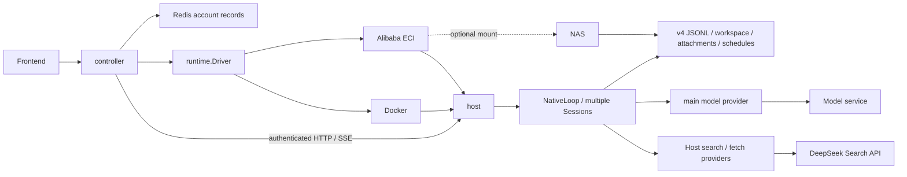

# Architecture

Each account opens a personal Host with multiple durable Agent sessions.
The Controller manages accounts and compute, and Redis stores the account
configuration and lifecycle state. The Host owns the agent runtime and filesystem.

## Source layout

| Directory | Responsibility |
|---|---|
| cmd/controller | Configuration, management CLI and external HTTP entry |
| cmd/host | Container process entry |
| harness | Native AgentLoop, v4 Session, assembly, tools and Agent features |
| internal/hostruntime | Multiple Sessions, child/fork lifecycle, replay and execution |
| internal/host | Host composition, main-chat initialization and readiness |
| internal/controller | Account lifecycle and streaming proxy |
| internal/httpapi | Authenticated session HTTP surface |
| internal/config, internal/localstate | Deployment configuration, private profile writes and local image-cache operation state |
| runtime, web | Small public capability interfaces and normalized types |
| providers/runtime | Docker and ECI implementations |
| providers/model, providers/web, providers/image | Model, search, page-fetch and image-generation implementations |
| thirdparty | Our integration code around external SDKs and HTTP APIs |
| client, examples | Go client and minimal frontend integration |
| build, harness/skills | Public Host image and built-in Skill support |
| extensions/cordis, extensions/sdk | Shared plugin framework and asynchronous Go Host API |
| extensions/catalog | Reviewed remote plugin catalog and release validation |
| tests/integration | Real Docker Host acceptance tests |

SDKs are resolved through Go modules. SDK request types remain inside thirdparty. Historical v1 helpers are only
under internal/testsupport and excluded from both production dependency graphs.

## Startup and identity

Controller loads the deployment profile and connects to Redis. Opening an
existing account starts or reconnects its Host. Controller saves the instance
ID before creating compute. Docker uses that ID in the container name.
ECI uses it as the client token and in resource tags so a retry can find the
same instance.

The driver supplies an address reachable from Controller. Docker
Hosts use dynamic published ports. ECI uses the private IP. After a successful
`/readyz` probe, Controller synchronizes model and provider settings and saves the endpoint
in Redis for session forwarding and readiness checks.

The Host checks its startup configuration and writable filesystem operations
before listening. It uses the Controller-supplied account ID and runs one active writer per
Session, with durable inbox admission and one active turn at a time. Multiple
Sessions and tool calls can execute concurrently. The Host pins the selected
session model at the start of each turn. Child Agents inherit that turn's
model, and a fork creates another context branch within the same Host.

Each new account reserves a stable main Session ID in its existing Redis hash.
Core startup prepares that Session without activating a model. Its constructor
publishes an initial system message followed by one ordinary assistant greeting.
On the first model step, the current system prompt replaces the initial system
through the existing append-only surface operation; the greeting remains an
assistant message and is eligible for ordinary compaction. It has no fabricated
model usage or execution turn. See [main-chat design](main-chat-and-first-run-plan.zh-CN.md).

Business plugin sources, original Skills and media are published independently in
[got-bot-plugins](https://github.com/xyc999-ai/got-bot-plugins), with versioned
GitHub Release archives and a public catalog. Controller caches and refreshes
that catalog; Host images contain only the shared runtime and SDK.

Default plugin selection is written once at account creation from the reviewed
catalog. The client automatically requests package preparation after core startup;
Host uses pnpm for missing packages and Cordis for activation. Installed matching
releases are reused, and later logins respect user disable/uninstall decisions.

Proactive assistance is a separate Go Host service and persistent Agent, not a
fork or Cordis core plugin. It binds an internal Go AgentPreset and drives
the existing `RunNext` with standard Inbox inputs. AgentLoop, tool pipeline,
checkpoint and compaction execution remain shared. The composition chooses real
static/dynamic tools and a consistent Skill view; ordinary chat keeps its full
composition. Background results use a fresh per-turn `structured_output` wrapper
and are accepted only after successful tool/result and turn/end commits.

The Host owns an independent AI-selected timer and a change-trigger window.
Bounded recent dialogue comes from the existing SQLite message index, filtered
to visible user/assistant text; research has its own journal. Standard time-context
is sampled before each run through the existing Inbox. Only an explicit notify
decision creates an `agent-message` in the main chat's next-turn queue. There is
no automatic child-settled report or main-chat worthiness review. The usual SSE
projection sends the main Agent's resulting reply, without exposing the relay
as a user bubble. Durable message IDs let interrupted I/O retry admission once.

Redis adds one `proactive` preference to the account Hash. Host stores only its
local recovery projection under `.dsh/storages/proactive.json`; Controller has no
background scheduling loop and never connects to Host SQLite. The small
`internal/proactivesettings` wire contract keeps Agent and SQLite dependencies
out of Controller's Alpine image. See [configuration](configuration.md#proactive-assistance)
and the [design and verification plan](proactive-discovery-plan.zh-CN.md).

## Agent Presets

One Go-owned `harness/agentpreset.Registry` serves the Host. Ordinary chats and
its main chat use the same `standard` preset; the main chat differs only by its
stable account identity, greeting, archive restriction and delivery role.
Background research uses `go-bot-proactive` through the same assembly pipeline.

An immutable binding selects inherited tools, Skills, System sections and runtime
sources. Local tool contributions merge before execution. Plugins and MCP still
refresh through the existing step boundary; memory refreshes normally. Presets
neither install plugins nor change their Cordis lifecycle. They do not choose a
model or replace execution permissions.

The creation Header stores the initial identity. Before the first turn, trusted
Go callers can select another preset by appending `agent-preset/selected`.
Recovery reads the effective projection; missing definitions fail execution
without hiding stored history. Live bindings retain their definitions across
registry replacements, and forks inherit the parent's current binding.
See the [Go design and implementation record](agent-preset-go-plan.zh-CN.md).

## Session projections

The native Session owns typed, versioned projection registrations. Accepted
event batches drive live state only after the whole batch succeeds; durable
readers advance independently to the confirmed journal watermark. Goal
transition validation uses the same reducer against speculative state before
acceptance, preserving batch rollback and revision checks.

Goal, Plan, policy, working directory, execution boundaries, usage, questions,
child catalogs and background decisions read incremental state rather than
replaying a full event snapshot. Process-local Goal activation remains disarmed
after recovery. Model preparation caches current surface messages and refreshes
changed content after replacement, pruning or image offload. Its current-context
view omits the growing replacement audit trail; diagnostic snapshots retain it.

These projections do not add persistence files. The canonical v4 journal remains
the recovery source. History readers capture a durable event cut with queue and
policy state, select bounded event or turn windows, and index attachment
membership. A cold file version is fully validated once; an in-memory offset
index then serves range reads without retaining all event bodies. File changes
or cache eviction require another full observation. Search drains bounded pages
into SQLite before reporting synchronization complete. See the
[upstream comparison and implementation record](session-projection-parity-plan.zh-CN.md).

## Storage

The same native file I/O serves Docker volumes, ECI container storage and ECI
NAS.
The Host data root is `/root/harness`. Session journals live at
`$DSH_HOME/sessions/<project-key>/<session-id>/session.v4.jsonl`, where the
image sets `DSH_HOME=/root/harness/.dsh`. The project key comes from the
initial workspace path stored in the journal header's `cwd`. A manually created
session defaults to `/root/harness/workspaces/<session-id>`. Multiple sessions
can choose the same workspace, each with its own journal. Archiving preserves the
workspace and journal. Attachments live under `$DSH_HOME/attachments/v1`
and Host-wide schedules use `$DSH_HOME/storages/schedule.json`. Both user
skill roots also share the data root.
OfficeCLI and agent-browser are packaged as plugins in the image. New accounts
select them by default; plugin preparation installs their CLI dependencies, and
enabled plugins contribute the upstream Skills from their installed packages.

One Controller manages the deployment and serializes lifecycle changes for
each account. ProcessClaims prevents duplicate Session activation inside a Host.

Replacement Docker containers mount the same named volume for the account.
Replacement ECI instances with NAS mount the account's NAS directory.
ECI container storage uses the instance's writable layer for its lifetime.

## Requests and lifecycle

The controller proxies public Session and capability paths with the
internal Host token. It streams responses immediately and avoids replaying
an uncertain message POST. Session events have durable sequence
cursors; transient model fragments remain distinct. The internal Host shutdown
route is not exposed through this proxy.

Controller manages Host lifecycle through explicit requests. A stop request
waits for Docker to stop or ECI to be removed. Release retains the account
and external storage. Host owns its own schedule execution and stores the
model selection for sessions it creates alongside its durable data.

Model and search requests originate inside Host. Each client uses the key from
its own configuration. The controller validates the search provider and key
before launch. Public network fetches validate resolved targets.
The Host shell has the user's container-wide authority, including access to its
model/search keys and other Sessions. It is not a multi-tenant isolation layer.

See [configuration](configuration.md), [deployment](deployment.md),
[provider extension](providers.md) and [development checks](../CONTRIBUTING.md#development-and-verification).

## Business plugins

Each Host may start one private Node/Cordis process. The built-in Host Bridge
provides `ctx.host` through bidirectional asynchronous JSON-RPC over a private
Unix socket. Go owns AgentLoop, Sessions and the unified PreExecute → Execute →
PostExecute → Result flow. Only selected plugin business callbacks cross RPC;
normal Go Session creation, checkpointing and result commits do not wait for
Node compatibility listeners. No pre-stage guard or remote middleware is used.

Cordis Loader/Fiber/effect owns plugin dependencies and lifecycle. Go tracks
resource registrations and active calls, not a second plugin-instance state
machine. Controller Redis stores only per-package selections (catalog ID, version and enabled). Installed packages
live under `$DSH_HOME/plugins/profile`; no local plugins.json is generated. The Host
unifies package/dependency installation through pnpm and reviewed standard
lifecycle scripts before reporting installation success. Cordis activation
registers capabilities without installing software. Plugin credentials and
business/MCP grants use the one built-in Go credentials Store. Host has no Redis
access. Public SDK methods are Promise-based; native `host/*` notifications only
observe state and cannot replace tool results. See [plugin API](api.md#plugins)
and [SDK](../extensions/sdk/README.md).
