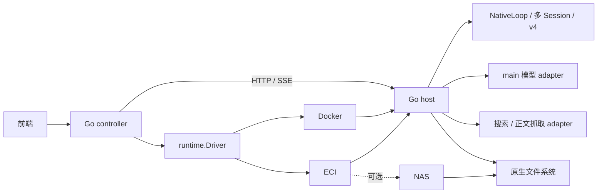

# Go Harness 独立仓库架构与迁移方案

> 历史设计与调研记录。当前行为、配置和命令以[文档索引](README.md)中的指南为准。

2026-11-10 的初次迁移设计记录。当前 Host 启动契约、环境文件和 ECI 镜像缓存流程见 [ECI 镜像缓存与启动配置方案](eci-build-and-start-plan.zh-CN.md)，实际验证范围见 [validation.md](validation.md)。

## 1. 定位与边界

仓库主体是以 Go 实现、使用 NativeLoop 与 DeepSeek Harness v4 会话格式的个人 Agent 后端。一个 Host 是一个用户的容器云电脑，承载多个会话、工具、工作区和可恢复日志。前端只需通过 HTTP 创建会话、发消息、订阅 SSE、上传附件和下载产物。

两个入口固定为 `cmd/controller` 和 `cmd/host`。controller 是可选的外部管理进程，负责启动云电脑和提供固定入口；host 是可独立打包启动的主服务。模型和搜索由 Host 直接调用，不通过原有 AI 或 gateway 中转。

LifeClaw 保留全部现有实现，本次只读取和复制，不反向修改。新仓库没有 Redis 运行、构建、测试或可选依赖，也没有 Host 注册、分布式租约、账号体系或多租户调度。

## 2. 架构与目录



| 路径 | 职责 |
|---|---|
| cmd/controller、cmd/host | 两个可执行程序入口 |
| harness | AgentLoop、assembly、Session、工具、附件、child、Goal、Plan、问答、Jobs、Workflow、Schedule、Skills |
| internal/hostruntime | 多会话激活、恢复、子 Agent 与 Host 执行管理 |
| internal/host | Host 装配、数据身份、就绪和闲置退出 |
| internal/controller | 本地管理状态、Ensure/Inspect、就绪检查和透明代理 |
| internal/httpapi | 会话 HTTP、鉴权、SSE 与文件访问 |
| internal/config、internal/localstate | 严格配置、凭证解析、状态和本地锁 |
| runtime、web | 对外的小型能力接口与标准化类型 |
| providers/runtime | Docker、ECI 运行环境实现 |
| providers/model、providers/web | 主模型、搜索与正文抓取实现 |
| thirdparty | 本项目编写的第三方 SDK/API 接入封装 |
| client、examples | 薄 Go 客户端与最小前端示例 |
| configs、build、skills | 配置示例、镜像构建、默认技能 |
| api、docs、scripts、tests | OpenAPI、文档、启动/检查脚本与集成验收 |

第三方 SDK 和库由 go.mod/go.sum 引入。thirdparty 不存放 SDK 源码、上游仓库或许可证集合。项目许可证放根目录 LICENSE；真实使用的上游声明放 THIRD_PARTY_NOTICES.md，不设 licenses/third-party 目录。

## 3. 运行环境扩展

runtime.Driver 提供 Name、Capabilities、Validate、Preflight、Ensure、Inspect、Stop、Delete。公共 Spec/Instance/ResourceRef 不泄露云 SDK 类型；云请求和响应在 thirdparty 内转换。

Capabilities 声明支持的存储类型、是否能原地重启停止实例、是否提供平台停止。Docker 支持停止后原地重启和平台 stop；ECI 使用 Host 自身退出、重新创建实例。后续云提供方实现 driver、配置和凭证校验并注册 factory，无需修改 AgentLoop。

Ensure 使用已持久化的 operation ID。Docker 用确定的名称和归属 label 复用实例；ECI 用 ClientToken 和标签查询对账。创建结果不确定时先对账，不盲目创建第二台云电脑。归属信息包括 deployment ID、Host ID、run ID 和配置 revision；停止/删除前重新检查，拒绝其他部署的资源。

Inspect 返回 controller 实际可访问的地址。Docker 默认动态发布本机 loopback 端口，由 inspect 发现；ECI 查询私网 IP 和固定 Host 端口 8080。controller 必须具备对应网络连通性，拥有云 API 权限不能替代私网访问能力。

Preflight 不创建计算资源；Doctor 使用它进行诊断。实例进入 Running 之后还需通过带内部 token 的 /readyz，检查 Host、run、data 和 API 版本身份。通过后 controller 才监听前端入口。

## 4. 运行环境与存储分离

| 运行环境 | storage.type | 行为 |
|---|---|---|
| Docker | container（默认） | 使用容器可写层；原容器重启可保留，删除不承诺恢复 |
| Docker | volume | Docker 命名卷；计算容器删除后保留卷 |
| Docker | bind | 用户指定的独立绝对路径；容器删除不删除宿主目录 |
| ECI | container（默认） | 不要求 NAS，不附加 NAS Volume，不恢复退出后丢失的数据 |
| ECI | nas | 显式绑定已有 NAS 挂载点/子目录，通过原生文件 I/O 使用 |

ECI 不再强绑定 NAS。没有 NAS 时不会构造相关 Volume、VolumeMount，也不做临时磁盘备份。平台如何回收退出后的磁盘由平台决定，项目不给恢复承诺。NAS 只需填写挂载点地址，子目录由代码按部署和 Host 生成。选择 NAS 后，配置或挂载失败会阻止启动。

Host 数据根目录为 /root/harness，包含 workspaces、`$DSH_HOME/sessions` 下的 v4 日志、`$DSH_HOME/attachments/v1` 下的附件和 `$DSH_HOME/storages/schedule.json` 中的 Host-wide Schedule。用户 Skills 位于数据根内的 `$DSH_HOME/skills` 和 `$DSH_AGENTS_HOME/skills`。日志格式不混入 Docker/ECI 等部署字段。

启动校验写入、hard link、rename、文件/目录同步等文件系统能力。一个数据目录仅部署一个活跃 Host。本地锁防止同机重入，不承诺跨机器 NAS 协调。

## 5. 启动与生命周期

默认一条命令：

```bash
./scripts/start.sh
```

脚本在有 Go 时构建本机 controller；没有 Go 时用 Docker 构建本机二进制。先校验最终配置与必要凭证，再按需构建默认 Host 镜像，启动 Docker Host。默认前端入口为 127.0.0.1:8080；Host 在独立容器中监听 0.0.0.0:8080。

controller 使用默认 ~/.go-harness 状态目录，存储部署/操作身份、精确资源引用和入口地址。外部服务凭证不写入该状态 JSON。通信 token 使用独立 0600 文件，父目录权限为 0700。

controller 独占锁用于阻止两个本地 controller 同时管理同一份状态，例如重复执行启动命令。Host 数据目录有独立启动锁，Session 内部还有单写入者 claim。锁不是 Redis 的替代分布式服务，也不引入多机调度。

Ctrl-C 只停止 controller。host status/stop/delete 可在 controller 离线时操作保存的精确实例；host start 通过在线 controller 执行。Stop 请求 Host 优雅退出，Docker 可通过平台停止；没有平台停止能力时等待 Inspect 观察到退出。Delete 删除计算实例但不删除外部 volume、bind 或 NAS。

Host 默认空闲 24 小时退出，可设 idle_timeout 为零关闭。退出前 drain 并复查会话、工具和 Schedule 状态。重启 controller 可以接回原 Host；重建无持久存储 Host 则是新的空电脑，旧 Session 返回 404。

## 6. 模型和子 Agent

公开配置只保留 model.main。默认 DeepSeek preset 补齐 deepseek-flash、Responses、官方 URL 和上下文预算，通常只需提供 MODEL_API_KEY。也支持 custom 模型服务配置 URL、模型名以及 Responses/Chat Completions 协议；显式 MODEL_AUTH=none 可用于本地无密钥服务。

所有 child、fork 和 workflow child 都继承 main，不提供 subagentprofiles、子模型列表/选择工具或 provider/model 覆盖。fork 是执行过程中的会话/上下文分支，不额外创建 Docker/ECI 实例。

没有 maxoutputtokens 或 max_output_tokens 用户配置；普通请求使用供应商默认输出行为。上下文压缩、工具数量、模型调用次数和步骤限制仍由 Harness 内部策略控制。

Host 直接构造模型 HTTP 请求并处理流式协议。controller 不接触模型上下文，不负责模型中转，不发现旧 AI 进程。

## 7. Host 内网页搜索

已核对 DeepSeek Harness 当前上游默认搜索：DeepSeek Search API，POST https://api.deepseek.com/v1/tools/search；网页正文由本地 HTTP 抓取。首版 providers 只内置 deepseek-search-api 一个搜索引擎，不引入多个备用引擎的复杂默认配置。

web.SearchProvider 和 Registry 保留扩展入口，第三方引擎可以实现标准化结果、注册 factory、增加严格配置与凭证校验。搜索和正文抓取分离；搜索结果与网页内容均作为不可信外部数据交给 Agent。

网页搜索始终启用，通过 WEB_SEARCH_PROVIDER 选择 provider，并使用显式配置的 WEB_SEARCH_API_KEY。请求具备超时、取消、限流、响应体限制和禁止凭证重定向的处理。

## 8. 凭证与默认配置

启动时从公开模板 `.env.example` 生成私有 `.env`，或读取已有的环境文件。模板中的凭证和 `MODEL_URL` 留空。本地已迁移原有阿里云默认凭证，DeepSeek Key 仍留空。

运行模式、镜像、存储、环境地址和凭证由环境文件管理。低频调优使用可选 YAML，默认值由代码提供。进程环境变量在内存中覆盖文件配置，启动不写回文件。若覆盖值使配置无效，启动退出，原文件保持不变。

`MODEL_API_KEY` 与 `MODEL_URL` 持久化在环境文件。controller 状态文件 `state.json` 记录资源引用、状态和配置摘要。更多字段说明见 [configuration.md](configuration.md)。

| 材料 | 环境变量 | 需要场景/归属 |
|---|---|---|
| 模型 key | MODEL_API_KEY | 默认必需；仅注入 Host |
| 阿里云普通 ID/Secret | ALIBABA_CLOUD_ACCESS_KEY_ID、ALIBABA_CLOUD_ACCESS_KEY_SECRET | ECI；只在 controller，共用一组 |
| 搜索 provider 和 key | WEB_SEARCH_PROVIDER、WEB_SEARCH_API_KEY | 始终必填。当前内置 provider 为 deepseek-search-api |
| 内部 Host token | HOST_API_TOKEN | 可选，默认生成；controller 与 Host 通信 |
| 私有镜像仓库账号 | REGISTRY_USERNAME、REGISTRY_PASSWORD | ECI 需要私有镜像凭证时填写，仓库主机名从 REGISTRY_PUSH_IMAGE 提取 |

不考虑 STS、角色、临时凭证、自动续期或默认账号探测。全部阿里云接入显式构造普通 AK 客户端，用户在阿里云侧配置权限。NAS 无需另一组凭证。普通 Docker 不校验不启用的云配置。

镜像中不含凭证；仅按受控环境变量列表注入 Host 所需模型/搜索和内部 token。Host 内 Shell 具有用户自己的云电脑权限，因此能读自身模型/搜索密钥；云管理和 registry 密钥不进入 Host。

## 9. HTTP 和持久会话

保留创建/列举会话、发送消息、附件、事件分页、SSE、取消、文件列表/下载、usage、Goal、Plan、问答和 Schedule 历史接口，具体字段以 api/openapi.yaml 和 docs/api.md 为准。

消息持久进入 inbox 后返回 202/messageId，实际开始执行时才分配 turnId。未知 Session 不隐式创建。一个会话同一时间只执行一个 turn，多条输入通过 inbox 排队。

controller 监听回环地址并同源托管浏览器页面。透明流式代理使用独立的内部 Host token。内部 Host shutdown 不向前端代理。发生连接故障时不自动重放 POST；客户端通过持久事件游标恢复输出，再自行处理不确定的提交结果。瞬时模型分片不能替代持久日志。

## 10. 镜像、上游和开源工程

默认镜像基于公开 Debian/Go/Node 基础镜像，内置官方 OfficeCLI、LibreOffice、Chromium、Python、Node、PDF/OCR 工具和中日韩字体，不引用 LifeClaw 私有基础镜像或 OSS 技能包。

OfficeCLI 从官方 iOfficeAI/OfficeCLI release 引入，当前锁定 v1.0.160 和 Linux arm64/x64 SHA256。更新脚本读取官方稳定 release 后更新版本/校验锁；需重建和实测再发布，不在运行时隐式升级。

当前 NativeLoop/v4 主线及其回归测试从 LifeClaw 工作区复制，包含原有未提交的有效附件改动。历史 v1 仅保留测试辅助依赖，生产依赖图不得带入。迁移来源清单见 migration-files.json。

v4 基线固定在 DeepSeek Harness d743267388641bc76f17c45ce8b4c231aed1d32c；搜索行为另核对 fcc0ad462172522aaf5c93a7b2e01f6b9f0b0159。不宣称完整移植更新版上游的全部产品功能。原版 TypeScript 校验器仅为开发验证依赖，不是 Go 服务运行依赖。

英文/中文 README、OpenAPI、配置/架构/部署/扩展/兼容性文档、贡献与安全说明、LICENSE/上游声明、CI 和真实 Docker 集成测试随代码交付。未提供公共仓库地址前不虚构 GitHub URL 或可用的远端镜像。

## 11. 验收与后续扩展

验收包括独立构建、全仓测试/vet、关键路径 race、无 Redis/原仓库生产依赖、真实 Docker 三种存储、Shell→文件→SSE→恢复、启动脚本、离线管理、镜像文档/浏览器工具和原版 strict/current v4 恢复。

本次真实验证与尚未执行的云端项目集中记于 [validation.md](validation.md)。真实 ECI、NAS 重挂/NFS 行为和实际付费模型调用需要目标环境参数与凭证，不能以 fake 测试或 LifeClaw 旧记录冒充本仓库通过。

后续贡献可以添加 runtime driver、搜索 provider、模型协议 adapter 和工具；沿现有接口扩展，增加对应配置校验、针对性测试与文档。继续保持 Host 主体、controller 可选、无 Redis、单一 main、运行环境/存储分离这些默认约束。
